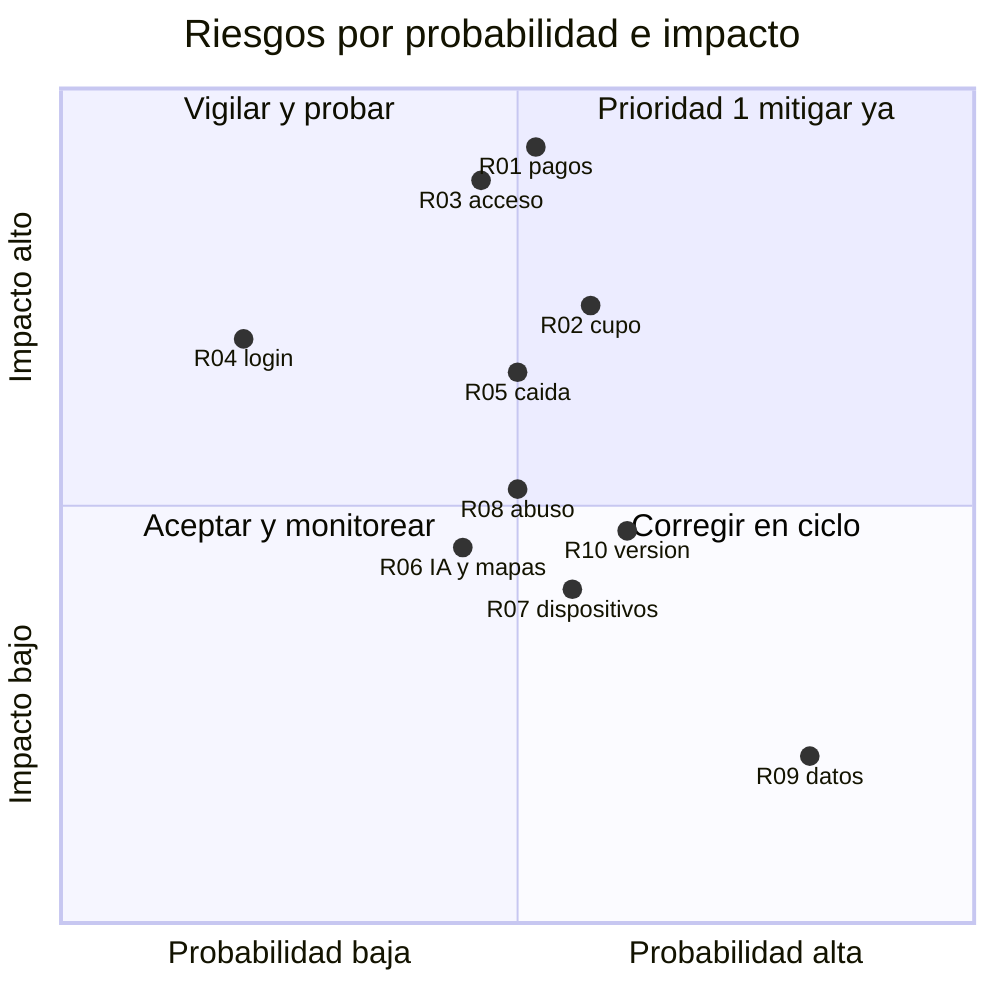

# Pruebas basadas en riesgos

Vinnot combina un catálogo con comunidad (riesgo medio) y eventos con pago (riesgo alto,
comparable a un comercio electrónico). Por eso el orden y la profundidad de las pruebas
siguen la probabilidad de falla y su impacto en el negocio: primero lo que puede causar
pérdidas económicas, filtración de datos o un bloqueo del acceso; después lo que degrada la
experiencia.

## Niveles de prueba

Cada nivel está documentado en la estrategia de su capa:

| Nivel | Qué cubre en Vinnot | Documento |
|---|---|---|
| Unitarias | Reglas del dominio, servicios de aplicación, validadores y mapeadores; son la base de la pirámide | [Backend](../backend/testing/strategy.md#pirámide-y-responsabilidades), [web](../frontend-web/testing/strategy.md), [app](../frontend-mobile/testing/strategy.md) |
| Integración | 58 suites contra PostgreSQL real en contenedores, pruebas HTTP de la API y contratos JSON y de clientes externos | [Backend: persistencia PostgreSQL](../backend/testing/strategy.md#backend-persistencia-postgresql) |
| Sistema / extremo a extremo | Playwright en la web; matriz manual en dispositivos físicos para la app | [Web: estrategia de pruebas](../frontend-web/testing/strategy.md) |
| Aceptación | Casos de prueba por módulo y validación del responsable de producto en desarrollo antes de producción | [Casos de prueba por módulo](../modules/traceability.md) y [Plan de pruebas](test-plan.md) |

## Riesgos

| ID | Riesgo | Probabilidad | Impacto | Nivel | Pruebas que lo mitigan |
|---|---|---|---|---|---|
| R-01 | Cobro duplicado o pago acreditado sin confirmación real | Media | Muy alto | Crítico | Funcionales e integración de pagos, webhooks con firma inválida, idempotencia |
| R-02 | Venta de más entradas que el cupo | Media | Alto | Crítico | Concurrencia y transición de estados de inscripciones |
| R-03 | Acceso no autorizado a datos o paneles de administración | Media | Muy alto | Crítico | Seguridad: control de acceso, autenticación, OWASP |
| R-04 | Usuarios que no pueden registrarse o iniciar sesión | Baja | Alto | Alto | Funcionales de autenticación, regresión, extremo a extremo |
| R-05 | Caída del servidor durante la venta de un evento | Media | Alto | Alto | Carga, estrés, monitoreo y recuperación |
| R-06 | Fallas del proveedor de IA o de mapas que bloqueen la app | Media | Medio | Medio | Tolerancia a fallos con servicios simulados |
| R-07 | Errores de visualización en algún dispositivo | Media | Medio | Medio | Compatibilidad en navegadores y dispositivos |
| R-08 | Contenido abusivo publicado sin control | Media | Medio | Medio | Funcionales de denuncias, bloqueos y moderación |
| R-09 | Datos incorrectos del catálogo (bodega mal ubicada, vino duplicado) | Alta | Bajo | Medio | Calidad de datos y revisión de propuestas |
| R-10 | Versión vieja de la app incompatible con la API | Media | Medio | Medio | Instalación y actualización con versión mínima |

### Probabilidad e impacto

[Ver diagrama de «Probabilidad e impacto» completo](https://images.vinnot.com/docs/diagrams/v1/es/quality-risk-based-testing-eac434cf3b05.svg)

## Tipos de prueba priorizados

| Prioridad | Tipo | Finalidad en Vinnot | Estado |
|---|---|---|---|
| 1 | Funcionales de pagos e inscripciones | Cupos, estados de la inscripción, acreditación solo con confirmación del servidor, reembolsos automáticos y emisión de entradas, con el sandbox de Mercado Pago | Implementado |
| 1 | Seguridad | Autenticación, autorización por rol, expiración y rotación de tokens, límites de tasa, cabeceras HTTPS, firmas de webhooks y dependencias; guía OWASP Top 10 y OWASP API Security Top 10 | Implementado |
| 1 | Regresión automatizada | Cada pull request ejecuta las suites y el quality gate bloquea si fallan | Implementado |
| 1 | Integración con base real | Consultas, transacciones y restricciones que no aparecen con datos simulados | Implementado |
| 2 | Funcionales del resto de los módulos | Registro, búsqueda, reseñas, cava, legal, denuncias y administración | Implementado |
| 2 | Extremo a extremo | Registrarse, verificar el correo, buscar y reseñar; inscribirse, pagar y ver la entrada | Parcial: web a pedido; app manual |
| 2 | Rendimiento y carga | Tiempos y capacidad ante picos, como la apertura de inscripciones de un evento popular, con k6 | Pendiente |
| 2 | Contrato de API | La web y la app entienden las respuestas aunque evolucionen por separado | Implementado |
| 2 | Compatibilidad | Navegadores, tamaños de pantalla y dispositivos iOS y Android | Parcial |
| 3 | Usabilidad | Personas completando tareas reales; mide M-11 y M-12 | Pendiente |
| 3 | Accesibilidad | WCAG 2.1 AA, lectores de pantalla y teclado | Manual; automática pendiente |
| 3 | Recuperación | Restaurar una copia y medir el tiempo real (M-17) | Parcial |
| 3 | Instalación y actualización | Instalar desde las tiendas, recibir OTA y bloquear versiones viejas | Manual |
| 3 | Localización | Textos completos en español e inglés, moneda y fecha | Implementado |
| 3 | Exploratorias | Sesiones cortas sin guion para encontrar lo que el plan no cubre | Manual |
| Continuo | Humo en producción | Tras cada despliegue: salud de la API, versión desplegada e inicio de sesión | Implementado |

## Pruebas estáticas

Además de ejecutar el software, el CI encuentra defectos sin ejecutarlo: revisión de cada
pull request con checklist, Checkstyle en el backend, ESLint y TypeScript en la web y la
app, actionlint en los workflows, verificación de arquitectura, Trivy, `npm audit` y
Gitleaks, y validación de la documentación bilingüe. El detalle de qué control corre en
cada cambio está en [CI/CD](../infra/guides/ci-cd.md#selección-de-controles) y en
[Seguridad de dependencias](../infra/guides/dependency-security.md).

## Técnicas de diseño de casos

Los casos de prueba de cada módulo combinan casos positivos y negativos con cuatro técnicas
de caja negra. Los casos completos están en la página de pruebas de cada módulo y en la
[matriz de trazabilidad](../modules/traceability.md).

| Técnica | Idea | Ejemplo en Vinnot |
|---|---|---|
| Partición de equivalencia | Agrupar entradas que el sistema trata igual y probar un representante por grupo | Búsqueda de vinos: texto vacío o de un carácter mantiene el catálogo filtrado; desde dos caracteres normalizados se envía la búsqueda (`RF-WEB-WIN-02`) |
| Valores límite | Probar los bordes de cada rango, donde se concentran los errores | Entradas por inscripción entre 1 y 20: probar 0, 1, 20 y 21. Página de 200 y 201 elementos. Inicio de sesión: intento 10 aceptado e intento 11 con HTTP 429 |
| Tabla de decisión | Combinar condiciones y su resultado | Webhook de pago: firma inválida → rechazo; firma válida fuera de la tolerancia de ±10 min → rechazo; firma válida y pago aprobado en Mercado Pago → acreditación; firma válida y pago no aprobado → sin acreditación |
| Transición de estados | Probar cambios de estado válidos e inválidos | Inscripción: `AWAITING_ATTENDEE_CONFIRMATION` pasa a `CONFIRMED` solo por el titular con la reserva vigente; con la reserva vencida se rechaza; `WAITLISTED` no asciende sola al liberarse cupo (`RF-WEB-EVT-11` y `RF-WEB-EVT-13`) |

### Tabla de decisión del webhook de pago

| Condición / resultado | C1 | C2 | C3 | C4 |
|---|---|---|---|---|
| Firma HMAC válida | No | Sí | Sí | Sí |
| Dentro de ±10 min | — | No | Sí | Sí |
| Pago aprobado en Mercado Pago | — | — | Sí | No |
| **Se acredita la inscripción** | No | No | Sí | No |
