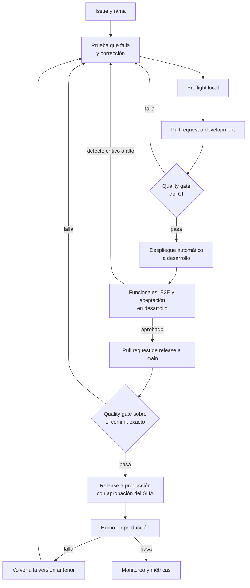

# Plan de pruebas

Plan maestro de pruebas de Vinnot con la estructura de la ISO/IEC/IEEE 29119-3. Define qué
se prueba, cómo, dónde, con qué criterios se aprueba un módulo o un release y quién hace
cada actividad. Nombra roles, no personas.

| Elemento | Detalle |
|---|---|
| Identificador | PP-VINNOT-01 |
| Producto | Vinnot: web, API y app móvil versión 0.2.2 o posterior |
| Rol responsable | Responsable de producto |
| Referencias | [Requisitos no funcionales](non-functional-requirements.md), requisitos funcionales por módulo, [Métricas](metrics.md), [Pruebas basadas en riesgos](risk-based-testing.md), [Casos de prueba no funcionales](non-functional-test-cases.md), casos de prueba por módulo en la [matriz de trazabilidad](../modules/traceability.md) |

## Objetivos

El objetivo general es dar confianza, con evidencia medible, de que cada versión puede
llegar a producción sin poner en riesgo el dinero, los datos ni la experiencia de las
personas usuarias.

- Verificar que los requisitos funcionales se comportan según lo especificado, incluidos
  los casos de error y los valores límite.
- Garantizar la exactitud del dinero: ninguna inscripción se confirma sin un pago real, no
  hay cobros duplicados sin reembolso y nunca se supera el cupo de un evento.
- Verificar la seguridad: autenticación, autorización por rol, protección contra abuso y
  ausencia de vulnerabilidades conocidas.
- Evitar regresiones con pruebas automáticas en cada pull request.
- Medir los atributos no funcionales (rendimiento, disponibilidad, recuperación,
  compatibilidad y accesibilidad) contra los umbrales de [Métricas](metrics.md).
- Detectar defectos lo antes posible, cuando corregirlos cuesta menos.
- Producir la información para decidir el release: qué funciona, qué no y qué riesgos se
  aceptan.

## Alcance

### Incluido

| Módulo o aspecto | Funcionalidades | Tipos de prueba |
|---|---|---|
| Usuarios y autenticación | Registro, verificación de correo, inicio y cierre de sesión, renovación, recuperación de contraseña, Google y Apple | Funcionales, seguridad, regresión, extremo a extremo |
| Catálogo de vinos | Búsqueda, filtros, paginación, detalle, límites del catálogo público | Funcionales, rendimiento, regresión |
| Escaneo y propuestas | Escaneo de etiquetas, propuesta de vino y límites de uso | Funcionales, rendimiento, dispositivos físicos |
| Reseñas y cava | Crear, editar y validar reseñas; promedios; "me gusta"; cava personal | Funcionales, autorización, regresión |
| Eventos, inscripciones y pagos | Listado, inscripción, cupo, estados, Mercado Pago, webhooks, reembolsos, entradas, gestión del partner | Funcionales, integración, seguridad, concurrencia, extremo a extremo |
| Legal y comunidad | Aceptación de términos, denuncias, bloqueos, moderación, seguimientos, perfiles públicos y visibilidad de la cava, muro, perfil y rueda de gustos, test de gustos | Funcionales, transición de estados, privacidad, accesibilidad |
| Administración | Usuarios y roles, reconfirmación de identidad, versión mínima de la app | Funcionales, seguridad |
| Aspectos no funcionales | Límites de tasa, HTTPS y cabeceras, rendimiento, copias, compatibilidad y accesibilidad | Seguridad, carga, recuperación, compatibilidad, accesibilidad |

### Fuera de alcance

- El funcionamiento interno de terceros (Mercado Pago, OpenAI, Google Maps, tiendas de
  aplicaciones): se prueba la integración, no el servicio.
- Rutas del vino, perfiles y comparaciones con IA, notificaciones y soporte: los cubren las
  pruebas automáticas de cada módulo, fuera de este plan.
- Pruebas de penetración externas: recomendadas antes de un crecimiento importante de
  usuarios.
- Tabletas: la app no las soporta oficialmente.

## Enfoque

- **Basado en riesgos:** orden y profundidad según [los riesgos R-01 a R-10](risk-based-testing.md#riesgos).
- **Automatización primero:** unitarias, integración y contrato en cada pull request; lo
  manual queda para usabilidad, accesibilidad, dispositivos físicos y exploración.
- **Shift-left:** cada defecto se reproduce con una prueba que falla antes de corregirlo.
- **Pruebas en producción controladas:** humo después de cada despliegue y monitoreo
  continuo.

## Entornos y herramientas

| Entorno | Uso |
|---|---|
| Local | Desarrollo y la misma verificación que el CI con `node scripts/ci-preflight.mjs` |
| CI (GitHub Actions) | Pruebas, cobertura, análisis estático y de seguridad, y quality gate en cada pull request |
| Desarrollo (`dev.vinnot.com`) | Funcionales manuales, extremo a extremo, carga y aceptación; Mercado Pago en sandbox |
| Producción (`vinnot.com`) | Solo humo y monitoreo; nunca datos de prueba destructivos |
| Dispositivos físicos | iPhone y Android para escaneo, notificaciones, accesibilidad e instalación |

| Herramienta | Versión | Uso |
|---|---|---|
| JUnit y Testcontainers | Gestionadas por Spring Boot 4.1.2 ([`pom.xml`](../../../backend/pom.xml)) | Pruebas del backend en Java 25 contra PostgreSQL 18 |
| JaCoCo | [`pom.xml`](../../../backend/pom.xml) | Cobertura y gates del backend |
| Vitest | 5.0.5 ([`package.json`](../../../frontend-react/package.json)) | Pruebas y cobertura de la web (React 19) |
| Testing Library | React 16.3; React Native 12.9 | Pruebas de componentes |
| Playwright | 1.64 ([`package.json`](../../../frontend-react/package.json)) | Extremo a extremo de la web |
| Jest con jest-expo | Jest 30.5; jest-expo 58 ([`package.json`](../../../frontend-mobile/package.json)) | Pruebas y cobertura de la app (Expo SDK 58, React Native 0.88) |
| Trivy y Gitleaks | 0.74.0 y 8.28.0 ([`install-security-tools.mjs`](../../../scripts/install-security-tools.mjs)) | Vulnerabilidades y secretos |
| k6 | — | Carga: pendiente |
| axe | — | Accesibilidad automática: pendiente |

## Criterios de entrada, suspensión y reanudación

- **Entrada:** el cambio está integrado en `development`, el CI pasó completo y el entorno
  de desarrollo responde con la versión esperada.
- **Suspensión:** el entorno no está disponible, falla el inicio de sesión (bloquea casi
  todos los casos) o aparece un defecto crítico en pagos.
- **Reanudación:** la causa de la suspensión está corregida y verificada en desarrollo; se
  repiten los casos afectados desde el principio.

## Criterios de aceptación

### Por módulo

Un módulo se aprueba cuando:

- pasa el 100 % de sus casos de prioridad alta y al menos el 95 % de los de prioridad media;
- no tiene defectos abiertos de severidad crítica ni alta, y los de severidad media tienen
  un plan de corrección;
- cumple los umbrales de cobertura de su capa ([RNF-23](non-functional-requirements.md#mantenibilidad-y-portabilidad));
- cada regla de negocio tiene una prueba automática que la verifica;
- los mensajes de error son claros y no exponen información interna;
- su documentación está actualizada en español e inglés.

### Por release

Un release se aprueba cuando:

- todos los módulos del alcance están aprobados;
- el quality gate del CI pasó sin verificaciones fallidas ni omitidas sobre el commit exacto
  que se libera ([Pull request de release a main](../infra/guides/release-step-by-step.md#5-pull-request-de-release-a-main));
- hay cero vulnerabilidades altas o críticas y cero secretos expuestos;
- los flujos críticos de pago se verificaron de extremo a extremo en sandbox;
- las métricas de rendimiento cumplen su umbral o el desvío está aceptado y documentado por
  el responsable de producto, como el tiempo de escaneo ([M-06](metrics.md#m-06-tiempo-de-escaneo-p95));
- existe una versión anterior a la cual volver y el procedimiento está probado
  ([Volver atrás](../infra/guides/release-step-by-step.md#volver-atrás));
- tras el despliegue pasan las pruebas de humo: salud de la API, versión desplegada igual al
  commit liberado e inicio de sesión ([Producción: backend y web](../infra/guides/release-step-by-step.md#6-producción-backend-y-web)).

Para la app, el release sigue además el paso de [App móvil](../infra/guides/release-step-by-step.md#8-app-móvil):
build nativo o actualización OTA según el tipo de cambio.

## Severidad de los defectos

| Severidad | Definición | Ejemplo |
|---|---|---|
| Crítica | Pérdida de dinero o de datos, brecha de seguridad o sistema inutilizable | Se confirma una inscripción sin pago |
| Alta | Una funcionalidad principal no funciona y no hay alternativa | No se puede iniciar sesión con Google |
| Media | Funciona con errores o hay alternativa | Un filtro no se limpia al cambiar el país |
| Baja | Problema estético o de texto | Un texto sin traducir al inglés |

## Ciclo de pruebas por release

[Ver diagrama de «Ciclo de pruebas por release» completo](https://images.vinnot.com/docs/diagrams/v1/es/quality-test-plan-b33934b51876.svg)

## Calendario y roles

| Actividad | Rol | Momento |
|---|---|---|
| Pruebas automáticas | Desarrollo | En cada pull request |
| Funcionales y extremo a extremo en desarrollo | Desarrollo y responsable de producto | Antes de cada pull request de release a `main` |
| Carga y recuperación | Desarrollo y operación | Antes de un lanzamiento importante y luego cada trimestre |
| Usabilidad y accesibilidad | Responsable de producto con 5 a 8 usuarios | Cada trimestre |
| Humo en producción | Operación | Después de cada despliegue |

## Artefactos resultantes

- Este plan y los casos de prueba con su resultado.
- El reporte del CI, el reporte de cobertura y el reporte de seguridad (SBOM incluido).
- El resumen de [Métricas](metrics.md) actualizado.
- El informe de release con los riesgos aceptados.

## Riesgos del plan

| Riesgo | Mitigación |
|---|---|
| Equipo reducido: el mismo rol desarrolla y prueba | Automatización, checklist previo al merge y revisión de cada pull request |
| Desarrollo tiene menos recursos que producción: las mediciones de rendimiento no se extrapolan | Medir en producción fuera del horario pico |
| El sandbox de Mercado Pago no reproduce todos los casos reales | Piloto con montos bajos antes de habilitar pagos reales |
