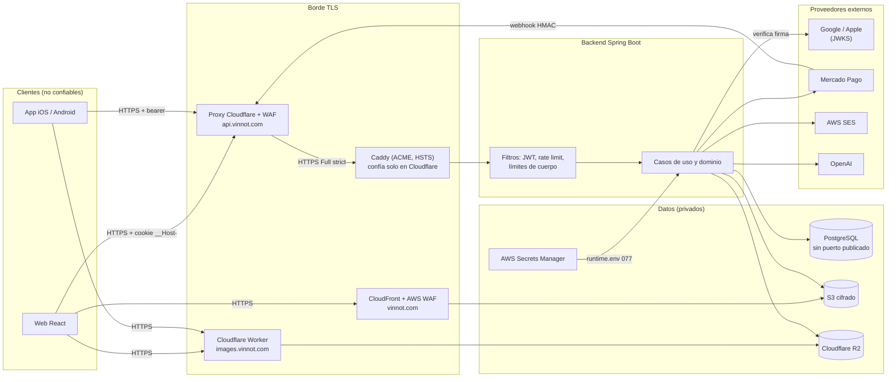

# Seguridad

Este capítulo es la vista transversal de la seguridad de Vinnot: cómo se guardan
las contraseñas, cómo se autentica cada cliente, qué controles hay en cada capa,
qué servicios externos intervienen y qué límites conocidos quedan abiertos. No
repite el detalle de cada módulo: resume los hechos clave con su fuente y enlaza
la página profunda que los explica.

## ¿Es segura la app?

Respuesta corta: Vinnot aplica controles reconocidos en todas las capas, están
implementados en el código y la infraestructura que se citan, y tienen límites
conocidos y documentados. Ningún sistema es invulnerable; esta sección describe
lo que existe, no promete ausencia de fallos.

| Aspecto | Estado | Resumen |
|---|---|---|
| Contraseñas | implementado | BCrypt con el costo por defecto de Spring Security (10); nunca se guarda texto plano. [Detalle](passwords-and-authentication.md#hash-de-contraseñas) |
| Sesiones | implementado | Access JWT de 15 minutos; refresh opaco de 7 días, rotado en cada uso y guardado como SHA-256. [Detalle](passwords-and-authentication.md#tokens-de-acceso-y-renovación) |
| Revocación inmediata | implementado | Cada request con bearer consulta la base: cuenta activa, no suspendida, misma `session_version` y mismos roles. [Detalle](passwords-and-authentication.md#invalidación-inmediata) |
| Acciones sensibles | implementado | Reautenticación con prueba de 5 minutos para borrar la cuenta, cambiar el correo y operaciones administrativas destructivas. [Detalle](passwords-and-authentication.md#reautenticación-step-up) |
| Transporte | implementado | HTTPS en todos los dominios públicos, HSTS en API y web, buckets S3 que rechazan tráfico sin TLS. [Detalle](defense-in-depth.md#transporte) |
| Abuso | implementado | Rate limiting por política (credenciales 10/min, acciones de cuenta 5 cada 15 min) y límites de tamaño. [Detalle](defense-in-depth.md#aplicación) |
| Fuerza bruta y robo de sesión | implementado (2026-10-30) | Tras 5 contraseñas incorrectas seguidas, el inicio de sesión con contraseña se pausa 15 minutos; un refresh rotado que reaparece cierra todas las sesiones de la cuenta. [Detalle](passwords-and-authentication.md#bloqueo-temporal-del-inicio-de-sesión) |
| Eventos de seguridad | implementado (2026-10-30) | La tabla `security_events` registra accesos, fallos, bloqueos, reuso de refresh y cambios de cuenta durante 180 días. [Detalle](privacy-and-data-protection.md#registro-de-eventos-de-seguridad) |
| Borde de la API | mitigado (2026-10-30) | Proxy y WAF de Cloudflare delante de la API, y origen abierto solo a Cloudflare: está en el código y el runbook, pendiente de que el responsable lo aplique. [Detalle](defense-in-depth.md#borde-y-red) |
| Datos en reposo | implementado | Volumen EBS y buckets S3 cifrados; credenciales de Mercado Pago cifradas con AES-GCM. [Detalle](defense-in-depth.md#datos) |
| Cadena de suministro | implementado | Dependabot, Actions fijadas por SHA, gitleaks, Trivy, npm audit, SBOM CycloneDX y release con verificación de procedencia. [Detalle](defense-in-depth.md#cadena-de-suministro) |
| Verificación | verificado | Pruebas de seguridad obligatorias por ruta, rate limit y upload en el backend ([pruebas](../backend/architecture/security-and-authorization.md#pruebas-obligatorias)) y escaneos semanales en CI ([security-checks.yml](../../../.github/workflows/security-checks.yml)). |
| Límites conocidos | pendiente | Sin vista ni alertas sobre los eventos de seguridad ni actor en las acciones administrativas, sin monitoreo de errores en el cliente y sin firma de las actualizaciones OTA. [Lista priorizada](known-limitations.md) |

La postura es adecuada para una plataforma de una sola instancia con datos
personales básicos y pagos delegados a Mercado Pago: Vinnot no almacena datos de
tarjeta. Los puntos que conviene reforzar antes de crecer en escala están en
[Límites conocidos](known-limitations.md).

## Modelo de amenazas

### Activos

| Activo | Por qué importa | Protección principal |
|---|---|---|
| Cuentas y sesiones | Suplantar a una persona o a un administrador | BCrypt, bloqueo temporal, JWT corto, refresh rotado y hasheado con detección de robo, `session_version`, step-up |
| Datos personales | Correo, nombre, teléfono opcional, avatar, actividad | Acceso por sesión, ownership por operación, volumen cifrado |
| Credenciales de vendedores en Mercado Pago | Cobrar o reembolsar en nombre de un organizador | AES-GCM con contexto ligado al dueño, secretos fuera del repositorio |
| Inscripciones y pagos de eventos | Integridad económica | Firma HMAC del webhook, idempotencia, reconciliación |
| Catálogo y contenido | Extracción masiva, contenido malicioso | Sesión obligatoria, cupos diarios, validación y re-encode de imágenes |
| Secretos de la plataforma | Comprometen todo lo anterior | AWS Secrets Manager, `runtime.env` con permisos `077`, OIDC en release |
| Artefactos de release | Introducir código no revisado | Actions fijadas por SHA, imágenes por digest, checksums y verificación de procedencia |

### Actores

| Actor | Capacidad asumida |
|---|---|
| Visitante anónimo | Solo rutas públicas: autenticación, enlaces compartidos, términos vigentes, webhooks firmados |
| Persona usuaria | Su sesión y sus propios recursos |
| Organizador (`PARTNER`) | Sus eventos y su cuenta de cobro |
| Moderador / Administrador | Superficie `/admin/**`, con step-up en lo destructivo |
| Atacante externo | Credenciales filtradas, fuerza bruta, scraping, tokens sociales forjados, uploads maliciosos |
| Proveedor externo comprometido | Webhook falsificado, dependencia maliciosa |

### Fronteras de confianza

La primera frontera es la red pública; la segunda, el borde TLS (CloudFront con
WAF para la web; el proxy de Cloudflare con su WAF y, detrás, Caddy para la API);
la tercera, el filtro de autenticación del backend; y la última, los adaptadores
que hablan con la base, el almacenamiento y los proveedores externos. El proxy de
la API está en el código y en el
[runbook](../infra/architecture/aws-deployment.md#poner-cloudflare-delante-de-la-api)
desde el 2026-10-30; hasta que el responsable lo aplique, los clientes llegan
directo a Caddy.

[Ver diagrama de «Fronteras de confianza» completo](https://images.vinnot.com/docs/diagrams/v1/es/security-readme-cc66bfcb2c1f.svg)

Fuentes: [Caddyfile](../../../infra/aws-low-cost/Caddyfile),
[production-web-stack.json](../../../infra/aws-low-cost/production-web-stack.json),
[compose.postgres.yml](../../../infra/aws-low-cost/compose.postgres.yml),
[SecurityConfig.java](../../../backend/src/main/java/com/vinnot/shared/infrastructure/config/SecurityConfig.java)
y el [mapa de despliegue](../infra/architecture/aws-deployment.md).

## Mapa del capítulo

| Página | Responde |
|---|---|
| [Contraseñas y autenticación](passwords-and-authentication.md) | ¿Cómo hasheamos contraseñas? ¿Cómo autenticamos en web, app y con Google o Apple? ¿Qué pide reautenticación? |
| [Defensa en profundidad](defense-in-depth.md) | ¿Qué controles hay en red, transporte, HTTP, aplicación, datos, pagos, secretos, mobile y cadena de suministro? |
| [Servicios externos de seguridad](external-security-services.md) | ¿Qué librerías y proveedores usamos para autenticar o defendernos, y dónde se configuran? |
| [Privacidad y protección de datos](privacy-and-data-protection.md) | ¿Qué datos personales guardamos, cómo se borran y cuánto duran los backups? |
| [Límites conocidos](known-limitations.md) | ¿Qué falta y en qué orden conviene resolverlo? |
| [Explorador de capas](security-explorer.mdx) | Vista interactiva de las capas de defensa y el estado de cada control |

## Páginas profundas relacionadas

- [Autenticación, identidad y ciclo de cuenta](../backend/architecture/authentication-and-identity.md)
- [Seguridad, autorización y protección de abuso](../backend/architecture/security-and-authorization.md)
- [Sesiones, publicación y efectos externos](../backend/architecture/session-and-data-integrity.md)
- [Protección de recursos y transportes externos](../backend/architecture/resource-protection.md)
- [Entornos, configuración y secretos](../infra/architecture/environments-and-secrets.md)
- [Seguridad de dependencias y artefactos](../infra/guides/dependency-security.md)
- [Backup y recuperación ante desastre](../infra/operations/backup-and-disaster-recovery.md)
- [Observabilidad e incidentes](../infra/operations/observability-and-incidents.md)
- [Pagos](../modules/payments/README.md) y [Legal](../modules/legal/README.md)
