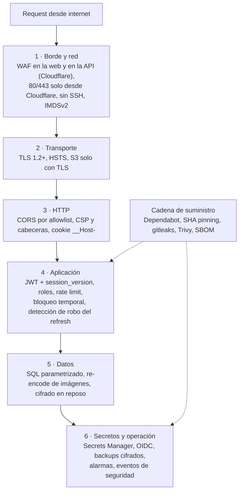

# Defensa en profundidad

Vinnot no depende de un único control. Cada capa asume que la anterior puede
fallar y agrega su propia barrera. Esta página lista los controles capa por capa,
con su fuente, y enlaza la página que los explica en detalle.

## Capas de defensa

[Ver diagrama de «Capas de defensa» completo](https://images.vinnot.com/docs/diagrams/v1/es/security-defense-in-depth-40b81889f17e.svg)

La [vista interactiva](security-explorer.mdx) muestra las mismas capas con el
estado de cada control. Los estados se revisaron el 2026-10-30: **implementado**
está en el código y en la cuenta; **mitigado** está en el código y las plantillas,
pero el responsable de la infraestructura todavía tiene que aplicarlo; **decisión
aceptada** se conserva a conciencia; **pendiente** no existe todavía.

## Borde y red

| Control | Estado | Fuente |
|---|---|---|
| AWS WAF en la distribución CloudFront de la web, con los grupos administrados `AWSManagedRulesAmazonIpReputationList`, `AWSManagedRulesCommonRuleSet` y `AWSManagedRulesKnownBadInputsRuleSet` | implementado | [production-web-stack.json](../../../infra/aws-low-cost/production-web-stack.json) |
| Proxy de Cloudflare delante de la API (`api.vinnot.com` y `api-dev.vinnot.com`): conjunto de reglas administradas Free, protección DDoS y una regla de rate limiting sobre `/api/auth/*`. Bot Fight Mode queda apagado para que pasen los webhooks de Mercado Pago | mitigado el 2026-10-30: en el código y el runbook; pendiente de que el responsable lo aplique ([límite 2](known-limitations.md#mitigados-pendientes-de-aplicar)) | [runbook de Cloudflare](../infra/architecture/aws-deployment.md#poner-cloudflare-delante-de-la-api) |
| Caddy confía solo en los rangos de Cloudflare (`trusted_proxies`) y lee la IP del cliente de `CF-Connecting-IP`; de cualquier otro par usa la IP de la conexión | implementado en el [Caddyfile](../../../infra/aws-low-cost/Caddyfile) el 2026-10-30; rige en cada host al desplegarlo | [Caddyfile](../../../infra/aws-low-cost/Caddyfile), [proxy-trust-policy.test.mjs](../../../scripts/test/proxy-trust-policy.test.mjs) |
| Security group de producción: sin puerto 22; la plantilla abre 80 y 443 solo a los 15 rangos IPv4 de Cloudflare, sin regla de operador | mitigado el 2026-10-30: la plantilla coincide con el lanzamiento público; la cuenta (verificada el 2026-10-29) acepta 80 y 443 desde cualquier origen hasta que se aplique el stack, después del proxy ([límite 20](known-limitations.md#mitigados-pendientes-de-aplicar)) | [production-stack.json](../../../infra/aws-low-cost/production-stack.json), [despliegue en AWS](../infra/architecture/aws-deployment.md#3-restringir-el-origen-a-cloudflare) |
| Administración del host por AWS Systems Manager (SSM), sin SSH | implementado | ídem |
| IMDSv2 obligatorio (`HttpTokens: required`) en la instancia | implementado | [production-stack.json](../../../infra/aws-low-cost/production-stack.json) |
| PostgreSQL sin puerto publicado en el host; solo Caddy escucha en 80/443 | implementado | [compose.postgres.yml](../../../infra/aws-low-cost/compose.postgres.yml), [docker-compose.yml](../../../infra/aws-low-cost/docker-compose.yml) |
| Rol IAM del host con mínimo privilegio: SSM, lectura de un único secreto, envío SES desde un remitente, pull de un repositorio ECR, escritura de backups | implementado | [production-stack.json](../../../infra/aws-low-cost/production-stack.json) |
| Worker de imágenes que solo sirve claves que cumplen expresiones regulares estrictas; los SVG llevan CSP con `sandbox` | implementado | [worker.mjs](../../../infra/cloudflare/catalog-images/worker.mjs) |
| Contenedor del backend con usuario no root `vinnot` e imágenes fijadas por digest | implementado | [Dockerfile](../../../backend/Dockerfile) |

## Transporte

| Control | Estado | Fuente |
|---|---|---|
| TLS automático por ACME en Caddy para la API | implementado | [Caddyfile](../../../infra/aws-low-cost/Caddyfile) |
| Con el proxy, Cloudflare termina el TLS del cliente y vuelve a cifrar hacia Caddy en modo Full (strict) | mitigado el 2026-10-30: pendiente de que el responsable active el proxy | [runbook de Cloudflare](../infra/architecture/aws-deployment.md#poner-cloudflare-delante-de-la-api) |
| HSTS de la API: `max-age=31536000; includeSubDomains` (1 año) | implementado | ídem |
| CloudFront con política mínima `TLSv1.2_2021`, redirección a HTTPS, HTTP/2 y HTTP/3, certificado ACM | implementado | [production-web-stack.json](../../../infra/aws-low-cost/production-web-stack.json) |
| HSTS de la web: `max-age=15552000` (180 días) | implementado | [security-headers.json](../../../frontend-react/security-headers.json) |
| Los buckets S3 rechazan todo acceso sin TLS (`aws:SecureTransport = false` → Deny) | implementado | [production-stack.json](../../../infra/aws-low-cost/production-stack.json) |
| La app mobile mantiene App Transport Security por defecto en iOS | implementado | [app.config.ts](../../../frontend-mobile/app.config.ts) |

## HTTP

| Control | Estado | Fuente |
|---|---|---|
| CORS con allowlist exacta (`CORS_ALLOWED_ORIGINS`), credenciales permitidas, sin comodín | implementado | [SecurityConfig.java](../../../backend/src/main/java/com/vinnot/shared/infrastructure/config/SecurityConfig.java), [CORS](../backend/architecture/security-and-authorization.md) |
| CSRF deshabilitado porque la API es stateless con bearer; la única cookie (`__Host-vinnot-refresh`) se protege con `SameSite=Strict`, allowlist de `Origin` y la cabecera `X-Vinnot-Web-Session` | implementado | [BrowserSessionPolicy.java](../../../backend/src/main/java/com/vinnot/user/infrastructure/web/session/BrowserSessionPolicy.java) |
| Cabeceras de la API desde Caddy: HSTS, `X-Content-Type-Options: nosniff`, `Referrer-Policy: strict-origin-when-cross-origin`, sin cabecera `Server`; se descarta la cabecera `Forwarded` del cliente y `X-Forwarded-For` se reemplaza por un único valor, `{client_ip}` | implementado | [Caddyfile](../../../infra/aws-low-cost/Caddyfile) |
| Cabeceras de la web desde una política de CloudFront generada por [configure-web-security-headers.mjs](../../../scripts/configure-web-security-headers.mjs): CSP con `default-src 'self'`, `object-src 'none'`, `frame-ancestors 'none'`, `upgrade-insecure-requests`; `X-Frame-Options: DENY`; `Cross-Origin-Opener-Policy: same-origin-allow-popups`; `Permissions-Policy` sin cámara, micrófono ni pagos | implementado | [security-headers.json](../../../frontend-react/security-headers.json) |
| La CSP permite `'unsafe-inline'` en estilos | pendiente | [Límites conocidos](known-limitations.md) |

## Aplicación

### Autenticación y autorización

Resumen; el detalle está en [Contraseñas y autenticación](passwords-and-authentication.md).

- Todo lo que no está listado como público exige sesión, incluidas las lecturas
  del catálogo ([SecurityConfig.java](../../../backend/src/main/java/com/vinnot/shared/infrastructure/config/SecurityConfig.java)).
- Cada request con bearer valida firma, vencimiento, `session_version`, estado de
  la cuenta y roles contra la base.
- `@PreAuthorize` por permiso y comprobación de propiedad en cada caso de uso
  ([matriz de ownership](../backend/architecture/security-and-authorization.md#ownership)).
- Step-up de 5 minutos para las acciones destructivas.
- Bloqueo temporal: tras 5 contraseñas incorrectas seguidas, el inicio de sesión
  con contraseña se pausa 15 minutos; una cuenta inexistente compara contra un
  hash ficticio para tardar lo mismo (implementado el 2026-10-30,
  [detalle](passwords-and-authentication.md#bloqueo-temporal-del-inicio-de-sesión)).
- Detección de robo: un refresh rotado que reaparece fuera de la recuperación
  por `rotationId` cierra todas las sesiones de la cuenta (implementado el
  2026-10-30,
  [detalle](passwords-and-authentication.md#detección-de-robo-del-refresh-token)).

### Rate limiting

Bucket4j 8.21.0 con Caffeine, en memoria por instancia
([RateLimitingFilter.java](../../../backend/src/main/java/com/vinnot/shared/infrastructure/security/RateLimitingFilter.java),
[RateLimitPolicyResolver.java](../../../backend/src/main/java/com/vinnot/shared/infrastructure/security/RateLimitPolicyResolver.java),
valores en [application.yml](../../../backend/src/main/resources/application.yml#L199-L260)).
Al agotarse responde 429 con `Retry-After`.

| Política | Límite por defecto |
|---|---|
| Credenciales (login, social, reautenticación) | 10 por minuto |
| Acciones de cuenta (recuperar y restablecer la contraseña, verificar el correo, cambiar contraseña o correo, desactivar o borrar la cuenta) | 5 cada 15 minutos |
| Registro | 5 por hora |
| Refresh | 60 por minuto |
| Reportes de contenido | 10 por hora |
| IA | 20 por hora |
| Escaneo de etiquetas | 30 por hora |
| Propuestas de vinos | 10 por día |
| Catálogo autenticado | 60 por minuto y 1500 por día |
| Catálogo público | 180 por minuto y 1500 por día |
| Documentación de la API | 30 por minuto |
| General | 300 por minuto |

Una cuenta que agota el cupo diario del catálogo queda bloqueada para frenar la
extracción masiva; el personal de moderación está exento
([cupo diario](../backend/architecture/security-and-authorization.md#cupo-diario-del-catálogo)).
`RATE_LIMIT_TRUST_FORWARDED_FOR` es `false` por defecto y `true` en el
[docker-compose.yml](../../../infra/aws-low-cost/docker-compose.yml) desplegado,
porque Caddy reemplaza `X-Forwarded-For` por un único valor, `{client_ip}`. Así
un cliente tampoco puede falsificar su IP: lo que mande en esa cabecera se
descarta, y `{client_ip}` sale de `CF-Connecting-IP` solo cuando la conexión
viene de un rango de Cloudflare.

Los contadores viven en la memoria de la instancia. Es una **decisión aceptada**
(2026-10-30) porque hay un solo backend por entorno; se revisa al correr un
segundo backend ([decisiones de plataforma](../infra/architecture/hosting-and-runtime.md#decisiones-de-plataforma)).

### Tamaños, validación y errores

| Control | Valor | Fuente |
|---|---|---|
| Multipart | 10 MB por archivo, 15 MB por request | [application.yml](../../../backend/src/main/resources/application.yml#L38-L39) |
| Cuerpos JSON | 1 MB | [JsonRequestResourceFilter.java](../../../backend/src/main/java/com/vinnot/shared/infrastructure/web/JsonRequestResourceFilter.java) |
| Imágenes | 8 MB y como máximo 24 megapíxeles decodificados | [ImageResourceLimits.java](../../../backend/src/main/java/com/vinnot/shared/infrastructure/image/ImageResourceLimits.java) |
| Validación | Bean Validation en los requests e invariantes en los value objects del dominio | [protección de recursos](../backend/architecture/resource-protection.md) |
| Errores | El manejador genérico responde `An unexpected error occurred`, sin stack traces | [GlobalExceptionHandler.java](../../../backend/src/main/java/com/vinnot/shared/infrastructure/web/GlobalExceptionHandler.java) |
| Actuator | Expone `health`, `info` y `metrics`; los detalles y el resto exigen ADMIN | [application.yml](../../../backend/src/main/resources/application.yml#L67-L70) |

## Datos

| Control | Estado | Fuente |
|---|---|---|
| SQL parametrizado: JPA, `JdbcTemplate` y las consultas nativas usan parámetros enlazados; lo que se concatena son constantes o nombres de enum | implementado | [WineSearchNativeRepository.java](../../../backend/src/main/java/com/vinnot/wine/infrastructure/persistence/search/WineSearchNativeRepository.java) |
| Etiquetas de vino: MIME declarado y firma JPEG/PNG, resolución mínima, re-encode a JPEG de hasta 1600 px sin copiar metadata | implementado | [WineLabelUploadValidator.java](../../../backend/src/main/java/com/vinnot/wine/infrastructure/web/WineLabelUploadValidator.java), [uploads](../backend/architecture/security-and-authorization.md#uploads-y-contenido-no-confiable) |
| Imágenes optimizadas a WebP: se decodifican primero y se codifican con `cwebp` invocado sin shell | implementado | [WebpImageOptimizer.java](../../../backend/src/main/java/com/vinnot/shared/infrastructure/media/WebpImageOptimizer.java) |
| Nombres de archivo y rutas generados por el servidor, sin path traversal | implementado | [revisión de amenazas](../backend/architecture/security-and-authorization.md#revisión-de-amenazas-por-flujo) |
| Cifrado en reposo: volumen EBS cifrado; buckets S3 con SSE-AES256, versionado y Block Public Access | implementado | [production-stack.json](../../../infra/aws-low-cost/production-stack.json) |
| Credenciales de vendedores de Mercado Pago: AES-256-GCM con nonce de 12 bytes, tag de 128 bits y el contexto (dueño y campo) como datos autenticados, para impedir intercambiar cifrados | implementado | [PaymentCredentialCipher.java](../../../backend/src/main/java/com/vinnot/payment/infrastructure/security/PaymentCredentialCipher.java) |
| Cifrado de datos personales a nivel de aplicación | pendiente | [Límites conocidos](known-limitations.md) |

## Pagos

El flujo completo está en [Pagos](../modules/payments/architecture.md).

| Control | Detalle | Fuente |
|---|---|---|
| Firma del webhook | HMAC-SHA256 sobre `id:<data.id>;request-id:<x-request-id>;ts:<ts>;`, comparado en tiempo constante con `MessageDigest.isEqual`; firma inválida → 401 | [MercadoPagoWebhookSignature.java](../../../backend/src/main/java/com/vinnot/payment/infrastructure/security/MercadoPagoWebhookSignature.java) |
| Ventana de tiempo | El `ts` firmado debe estar a ±10 minutos del reloj del servidor | ídem |
| Idempotencia | Cabecera `X-Idempotency-Key` en las llamadas a la pasarela, clave de reembolso estable y `ON CONFLICT` al persistir | [MercadoPagoPaymentAdapter.java](../../../backend/src/main/java/com/vinnot/payment/infrastructure/gateway/MercadoPagoPaymentAdapter.java) |
| Conexión OAuth del organizador | `state` aleatorio de 32 bytes guardado como SHA-256 | [vincular cuenta de cobro](../modules/payments/use-cases/uc-pay-03-link-payment-account.md) |
| Datos de tarjeta | Nunca pasan por Vinnot: el checkout ocurre en Mercado Pago | [Pagos](../modules/payments/README.md) |

## Secretos

| Control | Estado | Fuente |
|---|---|---|
| Los secretos del backend viven en AWS Secrets Manager (`vinnot/prod/backend-*`) y el rol del host solo puede leer ese secreto | implementado | [entornos y secretos](../infra/architecture/environments-and-secrets.md) |
| `refresh-runtime-env.sh` escribe `runtime.env` con `umask 077` y lo reemplaza con un `mv` atómico | implementado | [refresh-runtime-env.sh](../../../infra/aws-low-cost/refresh-runtime-env.sh) |
| `JWT_SECRET`, `EVENT_PAYMENTS_WEBHOOK_SECRET`, `EVENT_PAYMENTS_CLIENT_SECRET` y `EVENT_PAYMENTS_ENCRYPTION_KEY` no tienen valor por defecto | implementado | [application.yml](../../../backend/src/main/resources/application.yml) |
| El release de producción usa OIDC de GitHub con el rol `vinnot-production-release`, sin claves de larga vida | implementado | [production-release.yml](../../../.github/workflows/production-release.yml), [production-release-stack.json](../../../infra/aws-low-cost/iam/production-release-stack.json) |
| Los despliegues de desarrollo usan claves de acceso de larga vida, acotadas por un permission boundary | pendiente | [Límites conocidos](known-limitations.md) |

## Mobile

| Control | Estado | Fuente |
|---|---|---|
| Sesión en `expo-secure-store` con `AFTER_FIRST_UNLOCK_THIS_DEVICE_ONLY` | implementado | [authSession.storage.ts](../../../frontend-mobile/src/infrastructure/storage/authSession.storage.ts) |
| Deep links validados: hasta 4096 caracteres, solo `https`, host `vinnot.com` o `dev.vinnot.com`, sin usuario, contraseña ni puerto, y solo rutas `/share/(wines\|events\|wine-routes)/<uuid>`; todo lo demás vuelve al inicio | implementado | [nativeIntent.ts](../../../frontend-mobile/src/domain/navigation/nativeIntent.ts), [+native-intent.tsx](../../../frontend-mobile/app/+native-intent.tsx) |
| Android App Links con `autoVerify` e iOS `applinks` | implementado | [app.config.ts](../../../frontend-mobile/app.config.ts) |
| Permisos: cámara para escanear etiquetas y ubicación solo en uso; Android bloquea `RECORD_AUDIO` y `SYSTEM_ALERT_WINDOW` | implementado | ídem |
| El OCR de la etiqueta corre en el dispositivo (ML Kit); el backend recibe la captura validada solo para identificar el vino o proponer uno nuevo | implementado | [escaneo de etiquetas](../modules/wines/architecture.md#escaneo-de-etiquetas) |
| Firma de código de las actualizaciones OTA, certificate pinning y detección de root / jailbreak | pendiente | [Límites conocidos](known-limitations.md) |

## Cadena de suministro

El detalle de cada escaneo y sus excepciones está en
[Seguridad de dependencias y artefactos](../infra/guides/dependency-security.md).

| Control | Frecuencia | Fuente |
|---|---|---|
| Dependabot: GitHub Actions semanal; npm (mobile, web, sitio de docs, herramientas de diagramas), Maven, Docker y Docker Compose mensual | programado | [dependabot.yml](../../../.github/dependabot.yml) |
| Política de workflows: rechaza Actions con SHA no revisado y runners `*-latest` | cada CI | [verify-workflow-policy.mjs](../../../scripts/verify-workflow-policy.mjs), [actions-policy.json](../../../infra/security/actions-policy.json) |
| actionlint y gitleaks sobre todo el historial | cada CI | [ci.yml](../../../.github/workflows/ci.yml) |
| Instalación de escáneres verificada por checksum | cada ejecución | [install-security-tools.mjs](../../../scripts/install-security-tools.mjs) |
| Trivy sobre Maven, la imagen del contenedor y el lockfile de Android; falla con HIGH o CRITICAL | semanal y en CI | [security-checks.yml](../../../.github/workflows/security-checks.yml) |
| `npm audit` con nivel `high` para web, mobile y docs | semanal y en CI | [audit-npm-dependencies.mjs](../../../scripts/audit-npm-dependencies.mjs) |
| SBOM CycloneDX de la imagen del backend | semanal y en cada release | [security-checks.yml](../../../.github/workflows/security-checks.yml), [production-release.yml](../../../.github/workflows/production-release.yml) |
| ECR con tags inmutables y escaneo al subir | cada push | [production-stack.json](../../../infra/aws-low-cost/production-stack.json) |
| Release: antes de tomar credenciales AWS verifica procedencia, la ejecución candidata, checksums, CI y el SHA de `main`; despliega la imagen por digest | cada release | [production-release.yml](../../../.github/workflows/production-release.yml), [release paso a paso](../infra/guides/release-step-by-step.md) |
| CodeQL, OWASP dependency-check y firma de imágenes con cosign | pendiente | [Límites conocidos](known-limitations.md) |

## Monitoreo y auditoría

| Control | Estado | Fuente |
|---|---|---|
| Métricas del host y una sonda externa cada 5 minutos en producción, con unas nueve alarmas por correo (memoria, disco, conexiones, antigüedad del backup, ratio de 5xx, presupuesto de IA, rebotes de SES, entre otras) | implementado | [observabilidad](../infra/operations/observability-and-incidents.md) |
| Avisos de seguridad por correo al cambiar o restablecer la contraseña, al pausar el inicio de sesión (`ACCOUNT_LOGIN_LOCKED`) y al borrar la cuenta | implementado | [AccountSecurityNoticeService.java](../../../backend/src/main/java/com/vinnot/user/application/service/AccountSecurityNoticeService.java) |
| Historiales auditables: cambios de versión mínima de la app, interruptores de tipos de push y anuncios | implementado | [V69](../../../backend/src/main/resources/db/migration/V69__app_minimum_versions.sql), [V59](../../../backend/src/main/resources/db/migration/V59__push_type_switches_and_outcomes.sql), [V60](../../../backend/src/main/resources/db/migration/V60__announcements.sql) |
| Backups diarios cifrados con `pg_dump`, verificados con `pg_restore --list`, retención de 30 días en producción | implementado | [backup y recuperación](../infra/operations/backup-and-disaster-recovery.md) |
| Registro de eventos de seguridad (`security_events`, V73): 12 tipos, entre ellos accesos y fallos, bloqueos temporales, reuso de refresh, cambios de contraseña, correo y rol, suspensiones y borrados; con IP y navegador, purgado a los 180 días | implementado el 2026-10-30 | [V73__security_events.sql](../../../backend/src/main/resources/db/migration/V73__security_events.sql), [privacidad](privacy-and-data-protection.md#registro-de-eventos-de-seguridad) |
| Vista de administración del registro, columna de actor en las acciones administrativas y alertas sobre los eventos; reporte de errores del cliente | pendiente | [Límites conocidos](known-limitations.md#prioridad-alta) |
