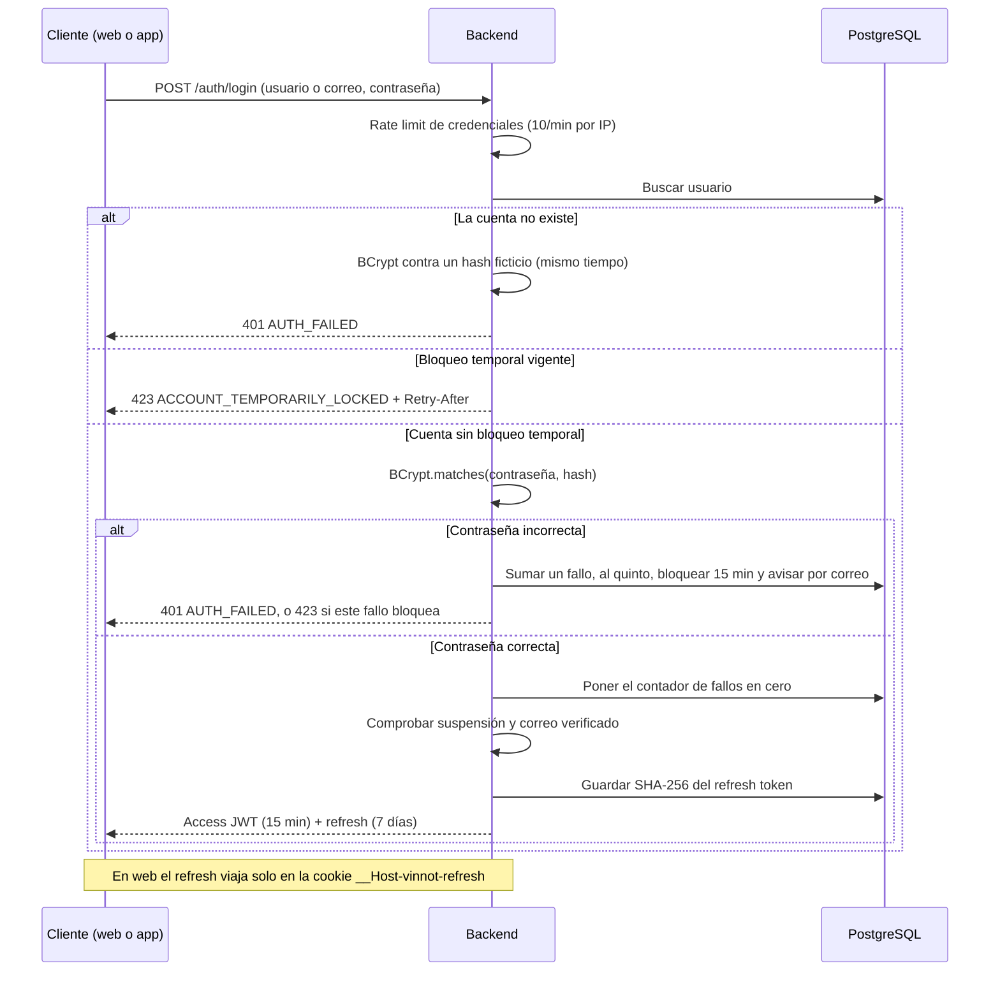
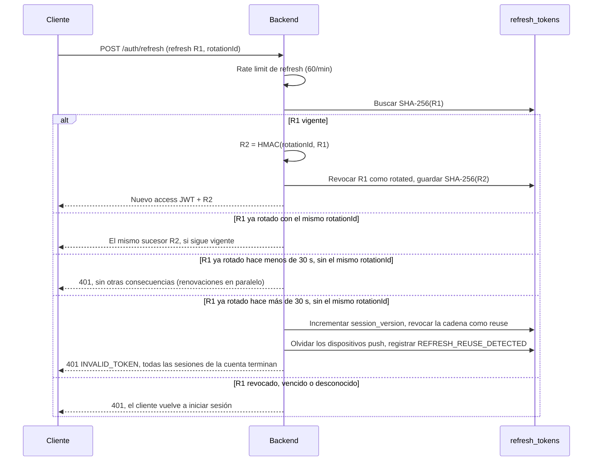
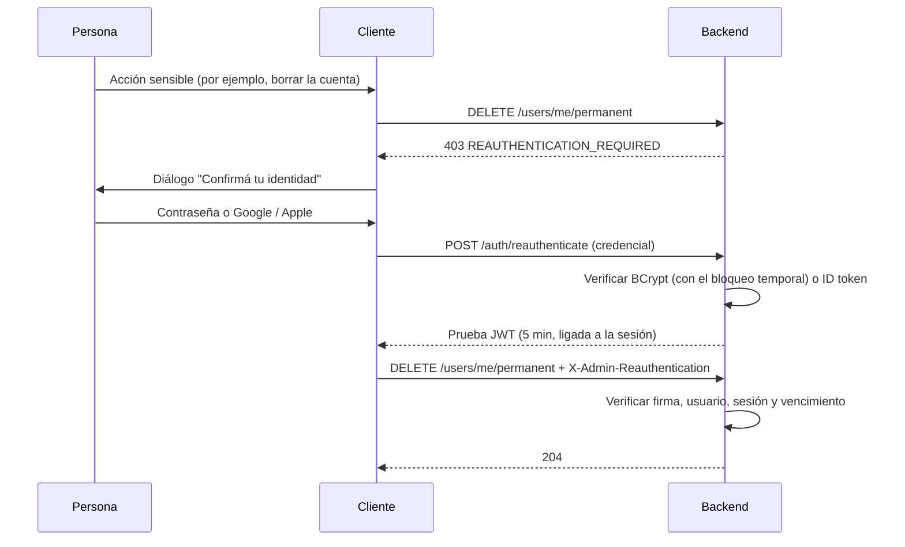

# Contraseñas y autenticación

Esta página responde cómo Vinnot guarda las contraseñas, cómo emite y renueva
sesiones, cómo verifica los inicios de sesión con Google y Apple y qué acciones
piden confirmar la identidad otra vez. El ciclo completo de cuenta (registro,
onboarding, avatar, errores de dominio) está en
[Autenticación, identidad y ciclo de cuenta](../backend/architecture/authentication-and-identity.md).

## Hash de contraseñas

| Elemento | Valor | Fuente |
|---|---|---|
| Algoritmo | BCrypt (`BCryptPasswordEncoder` de Spring Security) | [SecurityConfig.java](../../../backend/src/main/java/com/vinnot/shared/infrastructure/config/SecurityConfig.java#L177-L180) |
| Costo | 10 (2^10 rondas): el bean se crea sin argumentos y usa el valor por defecto de Spring Security | ídem |
| Sal | Aleatoria por contraseña, incluida en el propio hash BCrypt | comportamiento de BCrypt |
| Puerto de dominio | `PasswordHashingPort`, implementado por `PasswordHashingAdapter`; el dominio nunca ve BCrypt | [PasswordHashingAdapter.java](../../../backend/src/main/java/com/vinnot/user/infrastructure/identity/PasswordHashingAdapter.java) |
| Representación | El value object `Password` solo guarda el hash | [Password.java](../../../backend/src/main/java/com/vinnot/user/domain/valueobject/Password.java) |

La contraseña en texto plano solo existe durante el request que la recibe: se
valida, se hashea y se descarta. Los logs HTTP no registran cuerpos ni la cabecera
`Authorization`
([HttpRequestLoggingFilter.java](../../../backend/src/main/java/com/vinnot/shared/infrastructure/web/HttpRequestLoggingFilter.java)).

### Política de contraseñas

- Al menos 8 caracteres, con una mayúscula, una minúscula y un dígito; si no se
  cumple, el dominio responde `WEAK_PASSWORD`
  ([Password.java](../../../backend/src/main/java/com/vinnot/user/domain/valueobject/Password.java#L34-L48)).
- Los requests aceptan entre 8 y 100 caracteres
  ([RegisterRequest.java](../../../backend/src/main/java/com/vinnot/user/infrastructure/web/request/RegisterRequest.java),
  [ChangePasswordRequest.java](../../../backend/src/main/java/com/vinnot/user/infrastructure/web/request/ChangePasswordRequest.java)).
- BCrypt solo considera los primeros 72 bytes y no hay comprobación contra listas
  de contraseñas filtradas: ambos puntos están en [Límites conocidos](known-limitations.md).

## Tokens de acción de cuenta

Verificación de correo, cambio de correo y restablecimiento de contraseña usan el
mismo servicio,
[AccountActionTokenService.java](../../../backend/src/main/java/com/vinnot/user/application/service/AccountActionTokenService.java):

| Propiedad | Comportamiento |
|---|---|
| Entropía | 32 bytes de `SecureRandom`, codificados en base64url |
| Almacenamiento | Solo el hash SHA-256; el valor real viaja únicamente en el enlace del correo |
| Uso | Único: el token consumido guarda `usedAt` y no se acepta de nuevo |
| Emisión | Emitir uno nuevo invalida los activos del mismo tipo |
| Vigencia | Restablecimiento 60 min, verificación 1440 min (24 h), cambio de correo 60 min ([application.yml](../../../backend/src/main/resources/application.yml#L340-L342)) |

### Flujos que los usan

- **Verificación de correo:** el login se rechaza con `EMAIL_NOT_VERIFIED`
  hasta confirmar el correo
  ([LoginCommandHandler.java](../../../backend/src/main/java/com/vinnot/user/application/command/handler/LoginCommandHandler.java)).
  Caso de uso: [verificar correo](../modules/users/use-cases/uc-usr-02-verify-email.md).
- **Recuperar contraseña:** la respuesta es neutra, exista o no la cuenta
  ([solicitar recuperación](../modules/users/use-cases/uc-usr-09-request-password-recovery.md)).
- **Restablecer contraseña:** consume el token, guarda el nuevo hash, borra todos
  los refresh tokens, olvida los dispositivos push, borra el bloqueo temporal y su
  contador, y envía un aviso de seguridad por correo
  ([ResetPasswordCommandHandler.java](../../../backend/src/main/java/com/vinnot/user/application/command/handler/ResetPasswordCommandHandler.java),
  [restablecer contraseña](../modules/users/use-cases/uc-usr-10-reset-password.md)).
- **Cambiar contraseña o correo:** incrementan `session_version`, lo que corta
  las sesiones emitidas antes
  ([User.java](../../../backend/src/main/java/com/vinnot/user/domain/model/User.java)).

## Tokens de acceso y renovación

| Token | Formato | Vigencia | Almacenamiento en servidor | Fuente |
|---|---|---|---|---|
| Access token | JWT firmado con HMAC (jjwt 0.13.0), claims `email`, `roles`, `permissions`, `sessionVersion` | 15 min (`JWT_EXPIRATION`) | Ninguno: se verifica firma y vencimiento | [JwtTokenService.java](../../../backend/src/main/java/com/vinnot/shared/infrastructure/security/JwtTokenService.java), [application.yml](../../../backend/src/main/resources/application.yml#L97-L99) |
| Refresh token | Valor opaco aleatorio | 7 días (`JWT_REFRESH_EXPIRATION`) | Solo su hash SHA-256 en `refresh_tokens` | [RefreshTokenCommandHandler.java](../../../backend/src/main/java/com/vinnot/user/application/command/handler/RefreshTokenCommandHandler.java) |

La clave de firma sale de `JWT_SECRET`, que no tiene valor por defecto: el backend
no arranca sin ella.

### Inicio de sesión

[Ver diagrama de «Inicio de sesión» completo](https://images.vinnot.com/docs/diagrams/v1/es/security-passwords-and-authentication-ec1a58a440d4.svg)

### Bloqueo temporal del inicio de sesión

Implementado el 2026-10-30 (commit `67df1d2b`). Frena la fuerza bruta contra una
cuenta concreta, aunque el atacante reparta los intentos entre muchas IP
([LoginAttemptGuard.java](../../../backend/src/main/java/com/vinnot/user/application/service/LoginAttemptGuard.java),
[LoginAttemptRecorder.java](../../../backend/src/main/java/com/vinnot/user/application/service/LoginAttemptRecorder.java),
[LoginLockoutPolicy.java](../../../backend/src/main/java/com/vinnot/user/domain/valueobject/LoginLockoutPolicy.java)).

| Regla | Comportamiento |
|---|---|
| Umbral | 5 contraseñas incorrectas seguidas (`app.security.login-lockout.max-failures`, variable `LOGIN_LOCKOUT_MAX_FAILURES`) |
| Duración | 15 minutos (`app.security.login-lockout.lock-duration`, variable `LOGIN_LOCKOUT_DURATION`, valor `PT15M`) en [application.yml](../../../backend/src/main/resources/application.yml) |
| Respuesta | 423 `ACCOUNT_TEMPORARILY_LOCKED` con `Retry-After` en segundos, sea cual sea la contraseña, así que la respuesta no dice si la contraseña era correcta ([LoginLockoutExceptionHandler.java](../../../backend/src/main/java/com/vinnot/user/infrastructure/web/error/LoginLockoutExceptionHandler.java)) |
| Aviso | Un correo de seguridad `ACCOUNT_LOGIN_LOCKED` por bloqueo |
| Reinicio | Una contraseña correcta pone el contador en cero; restablecer la contraseña borra el bloqueo y el contador |
| Alcance | Inicio de sesión y reautenticación con contraseña. El login con Google o Apple no se ve afectado |
| Cuentas inexistentes | Comparan contra un hash BCrypt ficticio, así que tardan lo mismo que una contraseña incorrecta y el tiempo no revela qué cuentas existen |
| Datos | `users.failed_login_attempts` y `users.login_locked_until` ([V72__login_lockout.sql](../../../backend/src/main/resources/db/migration/V72__login_lockout.sql)); es independiente de la suspensión administrativa `users.locked` |
| Eventos | `LOGIN_FAILED`, `LOGIN_LOCKED` y `LOGIN_SUCCEEDED` en el [registro de eventos de seguridad](privacy-and-data-protection.md#registro-de-eventos-de-seguridad) |

El bloqueo se decide en la base de datos, en la misma sentencia que cuenta o
limpia: una ráfaga de intentos en paralelo abre un solo bloqueo y manda un solo
aviso, mientras dura no se cuenta ni se limpia, y una contraseña correcta nunca lo
levanta. La contraseña se compara sin ninguna transacción abierta, así que una
ráfaga no agota las conexiones a la base. El diseño completo está en
[bloqueo temporal del inicio de sesión](../backend/architecture/authentication-and-identity.md#bloqueo-temporal-del-inicio-de-sesión).

Compromiso aceptado: cualquiera que conozca el correo o el usuario puede pausar el
inicio de sesión con contraseña de esa cuenta durante 15 minutos, y después del
quinto fallo el 423 confirma que la cuenta existe. El rate limit de credenciales
por IP y la regla de Cloudflare sobre `/api/auth/*` siguen frenando a quien lo
provoca; ver el [límite 22](known-limitations.md#decisiones-aceptadas).

### Rotación del refresh token

Cada renovación revoca el refresh usado con el motivo `rotated` y emite uno
nuevo. Si el cliente reintenta la misma renovación con el mismo `rotationId`
(por ejemplo, tras perder la respuesta), el backend deriva con HMAC-SHA256 el
mismo sucesor en lugar de crear otro, sin extender su vencimiento.

[Ver diagrama de «Rotación del refresh token» completo](https://images.vinnot.com/docs/diagrams/v1/es/security-passwords-and-authentication-208ffe456300.svg)

### Detección de robo del refresh token

Implementado el 2026-10-30 (commit `67df1d2b`,
[RefreshTokenReuseResponder.java](../../../backend/src/main/java/com/vinnot/user/application/service/RefreshTokenReuseResponder.java)).
Un refresh ya rotado que vuelve a aparecer fuera de la recuperación idempotente
por `rotationId` significa que dos partes tienen la misma sesión, y una de ellas
la robó. Si la rotación ocurrió hace más de 30 segundos
(`app.security.refresh-reuse.grace-period`, valor `PT30S`), el backend, en su
propia transacción:

- incrementa `session_version`, lo que termina todas las sesiones de la cuenta;
- revoca la cadena de sucesores con el motivo `reuse`;
- olvida los dispositivos push de la cuenta;
- registra `REFRESH_REUSE_DETECTED`.

Las dos partes tienen que volver a iniciar sesión, y solo la dueña puede. Dentro
de los 30 segundos, la presentación solo se rechaza: así las renovaciones en
paralelo del mismo token no cuentan como robo. La app envía `rotationId`; la web
no, así que un reintento web pasados los 30 segundos cierra todas las sesiones.
Es una decisión aceptada ([límite 23](known-limitations.md#decisiones-aceptadas)).
El diseño completo está en
[reutilización del refresh token](../backend/architecture/authentication-and-identity.md#reutilización-del-refresh-token).

### Invalidación inmediata

El filtro
[JwtAuthenticationFilter.java](../../../backend/src/main/java/com/vinnot/shared/infrastructure/security/JwtAuthenticationFilter.java)
no confía solo en la firma del JWT. En cada request con bearer consulta la base
([AccountAccessAdapter.java](../../../backend/src/main/java/com/vinnot/user/infrastructure/persistence/adapter/AccountAccessAdapter.java))
y exige que la cuenta esté activa, no bloqueada, con la misma `session_version`
del token y exactamente los mismos roles. Si algo cambió, responde 401
`Session permissions have changed`.

`session_version` se incrementa al cambiar la contraseña, cambiar el correo
verificado, agregar, quitar o reemplazar un rol, desactivar la cuenta o
bloquearla ([User.java](../../../backend/src/main/java/com/vinnot/user/domain/model/User.java)).
Así un access token robado deja de servir en el siguiente request tras cualquiera
de esos eventos, sin esperar sus 15 minutos. El diseño completo está en
[sesiones versionadas](../backend/architecture/session-and-data-integrity.md#sesiones-versionadas).

## Dónde vive la sesión en cada cliente

| Cliente | Access token | Refresh token | Fuente |
|---|---|---|---|
| Web | Solo en memoria (Redux); los tokens heredados de `localStorage` se migran una vez y se borran | Cookie `__Host-vinnot-refresh`: `HttpOnly`, `Secure`, `SameSite=Strict`, `Path=/`, sin `Domain` | [persistence.ts](../../../frontend-react/src/presentation/stores/persistence.ts), [BrowserSessionPolicy.java](../../../backend/src/main/java/com/vinnot/user/infrastructure/web/session/BrowserSessionPolicy.java) |
| App iOS / Android | Registro único de sesión en `expo-secure-store` (Keychain / Keystore) con `AFTER_FIRST_UNLOCK_THIS_DEVICE_ONLY`: no viaja en backups a otro dispositivo | ídem | [authSession.storage.ts](../../../frontend-mobile/src/infrastructure/storage/authSession.storage.ts) |

Los endpoints de cookie `/auth/web/*` exigen además un `Origin` de la allowlist y
la cabecera `X-Vinnot-Web-Session: 1`, y rechazan requests con la cookie
duplicada para no elegir un valor inyectado. El detalle está en
[sesión de navegador](../backend/architecture/authentication-and-identity.md#sesión-de-navegador-y-reautenticación-administrativa).

## Inicio de sesión con Google y Apple

El cliente obtiene un ID token del proveedor y el backend lo verifica por su
cuenta con `spring-security-oauth2-jose` (Nimbus) en
[SocialIdentityVerifierAdapter.java](../../../backend/src/main/java/com/vinnot/user/infrastructure/identity/SocialIdentityVerifierAdapter.java).
Nunca se confía en datos de perfil enviados por el cliente.

| Proveedor | Firma (JWKS) | Issuer | Audiencia | Otros controles |
|---|---|---|---|---|
| Google | `https://www.googleapis.com/oauth2/v3/certs` | `https://accounts.google.com` o `accounts.google.com` | `GOOGLE_OAUTH_AUDIENCES` | `email_verified` y vencimiento |
| Apple | `https://appleid.apple.com/auth/keys` | `https://appleid.apple.com` | `APPLE_OAUTH_AUDIENCES` | `nonce` obligatorio y vencimiento; al borrar la cuenta se revoca la autorización en Apple ([AppleAuthorizationRevocationAdapter.java](../../../backend/src/main/java/com/vinnot/user/infrastructure/identity/AppleAuthorizationRevocationAdapter.java)) |
| Facebook | Graph API `debug_token` | — | `FACEBOOK_APP_ID` | Solo en desarrollo: el overlay productivo deja las credenciales vacías ([entornos](../infra/architecture/environments-and-secrets.md#disponibilidad-de-facebook-por-entorno)) |

Clientes: en mobile, `@react-native-google-signin/google-signin`,
`expo-apple-authentication` y `react-native-fbsdk-next`; en web,
`@react-oauth/google` y los SDK JS de Apple y Facebook. Caso de uso:
[login social](../modules/users/use-cases/uc-usr-04-social-sign-in.md).

## Reautenticación step-up

Algunas acciones piden confirmar la identidad aunque la sesión sea válida (el
diálogo "Confirmá tu identidad"). El usuario envía su contraseña o un ID token
fresco de Google o Apple (Apple con `nonce`), y el backend devuelve una prueba:

- un JWT HMAC válido **5 minutos**, ligado al usuario y al hash SHA-256 de la
  cabecera `Authorization` actual, firmado con una clave derivada y separada de la
  del access token
  ([SignedReauthenticationProofAdapter.java](../../../backend/src/main/java/com/vinnot/user/infrastructure/security/SignedReauthenticationProofAdapter.java));
- se envía en la cabecera `X-Admin-Reauthentication`;
- lo exige
  [AdminSensitiveActionInterceptor.java](../../../backend/src/main/java/com/vinnot/admin/infrastructure/web/AdminSensitiveActionInterceptor.java);
  sin prueba válida la respuesta es 403 `REAUTHENTICATION_REQUIRED`.

| Acción protegida | Quién |
|---|---|
| Escrituras en `/admin/users/**`, `/admin/notifications/**` (salvo la vista previa) y `/admin/app-versions` | ADMIN |
| `DELETE` en `/admin/**` y en vinos, eventos, rutas y bodegas | ADMIN |
| `POST /users/me/email-change` | Toda persona con sesión |
| `DELETE /users/me/permanent` | Toda persona con sesión |

[Ver diagrama de «Reautenticación step-up» completo](https://images.vinnot.com/docs/diagrams/v1/es/security-passwords-and-authentication-912e2befb3e3.svg)

Caso de uso: [reautenticar](../modules/users/use-cases/uc-usr-12-reauthenticate.md).
La prueba puede reutilizarse dentro de sus 5 minutos; ver
[Límites conocidos](known-limitations.md).

## Roles y permisos

- Roles: `USER`, `PARTNER`, `MODERATOR` y `ADMIN`
  ([Role.java](../../../backend/src/main/java/com/vinnot/user/domain/valueobject/Role.java)).
- Los permisos (`WINE_CREATE`, `EVENT_UPDATE_OWN`, etc.) viajan en el JWT como
  authorities y se aplican con `@PreAuthorize`; además, los casos de uso
  comprueban la propiedad del recurso.
- Reglas de URL en
  [SecurityConfig.java](../../../backend/src/main/java/com/vinnot/shared/infrastructure/config/SecurityConfig.java):
  `/actuator/**` y `/admin/users|notifications|app-versions` exigen ADMIN; el
  resto de `/admin/**` admite ADMIN o MODERATOR; las lecturas del catálogo exigen
  sesión; todo lo no listado como público exige autenticación.
- Swagger/OpenAPI tiene su propia cadena con HTTP Basic y rol ADMIN
  ([ApiDocumentationSecurityConfig.java](../../../backend/src/main/java/com/vinnot/shared/infrastructure/config/ApiDocumentationSecurityConfig.java)).

La matriz completa de permisos y propiedad está en
[roles, permisos y propiedad](../backend/architecture/security-and-authorization.md#roles-permisos-y-propiedad).

## Cierre de sesión

`POST /auth/logout` revoca el refresh token con el motivo `logout` y deja de
enviar notificaciones push a ese dispositivo, aunque la sesión ya hubiera vencido
([LogoutCommandHandler.java](../../../backend/src/main/java/com/vinnot/user/application/command/handler/LogoutCommandHandler.java)).
En web también borra la cookie y las pestañas abiertas se sincronizan por eventos
de `localStorage`
([browserSession.ts](../../../frontend-react/src/infrastructure/http/browserSession.ts)). Caso de uso:
[cerrar sesión](../modules/users/use-cases/uc-usr-08-sign-out.md).

## Fuerza bruta

- El rate limit de credenciales permite 10 intentos por minuto y el de acciones
  de cuenta 5 cada 15 minutos
  ([application.yml](../../../backend/src/main/resources/application.yml#L199-L260)).
- Tras 5 contraseñas incorrectas seguidas, el inicio de sesión con contraseña se
  pausa 15 minutos con 423 `ACCOUNT_TEMPORARILY_LOCKED`
  ([bloqueo temporal](#bloqueo-temporal-del-inicio-de-sesión), implementado el
  2026-10-30).
- Un usuario inexistente compara contra un hash BCrypt ficticio, así que el tiempo
  de respuesta no revela si la cuenta existe (implementado el 2026-10-30).
- `ACCOUNT_LOCKED` es otra cosa: la suspensión administrativa, que solo levanta un
  administrador.
- Con el proxy de Cloudflare, una regla de rate limiting sobre `/api/auth/*` se
  suma a la del backend (mitigado el 2026-10-30, pendiente de que el responsable
  lo aplique; ver [Defensa en profundidad](defense-in-depth.md#borde-y-red)).
