# Catálogo de imágenes

Todas las imágenes e ilustraciones que usan la web y la app, agrupadas por
función: para qué sirve cada grupo, dónde aparece y dónde vive el archivo. Cada
lámina muestra los archivos con su nombre, que es la clave que usa el código.
Las reglas de estilo y el pipeline de assets están en
[Ilustración, marca e imágenes](imagery.md).

Las rutas son relativas al repositorio. Cuando un grupo existe en las dos apps,
los archivos son los mismos en `frontend-react` y en `frontend-mobile`.

## Perfil de IA del vino

### Notas de aroma y sabor

Ilustran las notas de nariz y de boca en el perfil de IA (`AiProfilePage` en la
web, `AiProfileSections` en la app). El backend clasifica cada nota y la imagen
se busca por su clave.

- Web: `frontend-react/src/shared/assets/profile-art/notes/`
- App: `frontend-mobile/assets/images/profile-art/notes/`

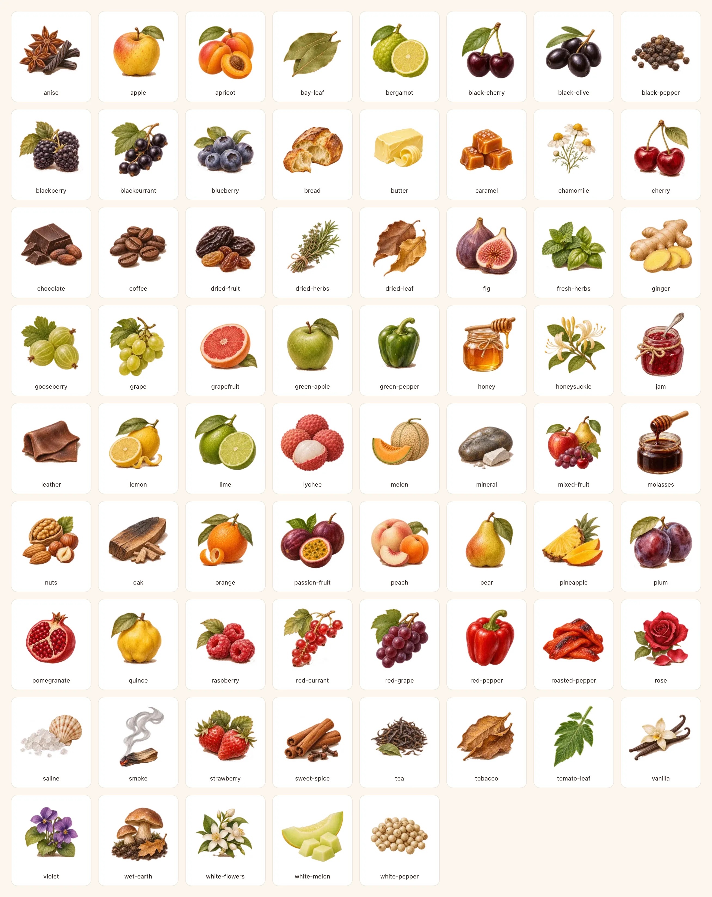

### Platos del maridaje

Ilustran los maridajes del perfil de IA.

- Web: `frontend-react/src/shared/assets/profile-art/dishes/`
- App: `frontend-mobile/assets/images/profile-art/dishes/`

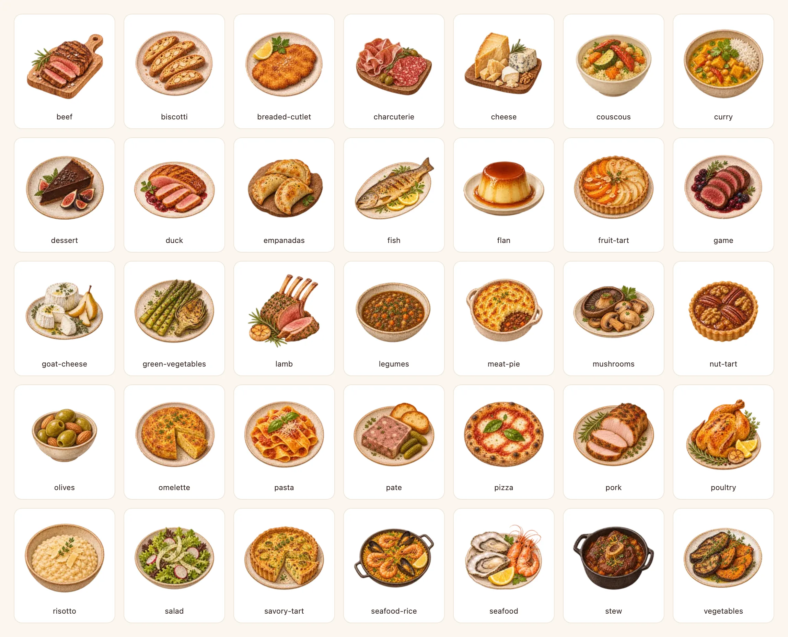

### Servicio

Copa recomendada, decantación (decantador o botella abierta) y guarda en la
sección de servicio del perfil de IA; cada caja muestra su ilustración arriba
del título y el texto.

- Web: `frontend-react/src/shared/assets/profile-art/serving/`
- App: `frontend-mobile/assets/images/profile-art/serving/`

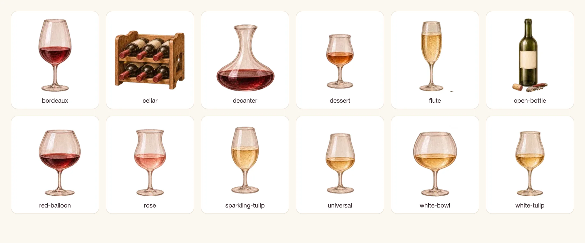

### Color del vino

Máscara de la pincelada de acuarela que da forma a la muestra de color del
perfil de IA (también en la página de administración). El color y los reflejos
se pintan por código; ver [la lámina de reflejos](imagery.md).

- Web: `frontend-react/src/shared/assets/wine-colors/stroke.webp`
- App: `frontend-mobile/assets/images/wine-colors/stroke.webp`

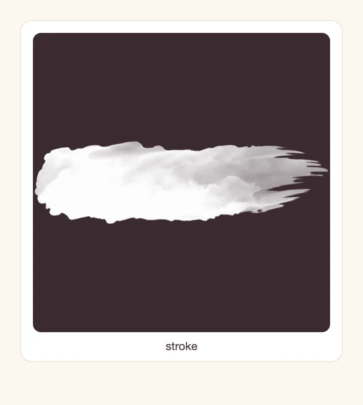

### Escenas de carga de IA

Piezas en capas de las escenas animadas que se muestran mientras se genera un
perfil o una comparación (`AiProfileLoadingSteps` y `CompareLoadingSteps` en la
web, `WineProcessScene` en la app). El corcho, el bozal, el sacacorchos y una
voluta también se usan en la animación de descorche del puntaje.

- Web: `frontend-react/src/shared/assets/loading/`
- App: `frontend-mobile/assets/images/loading/`

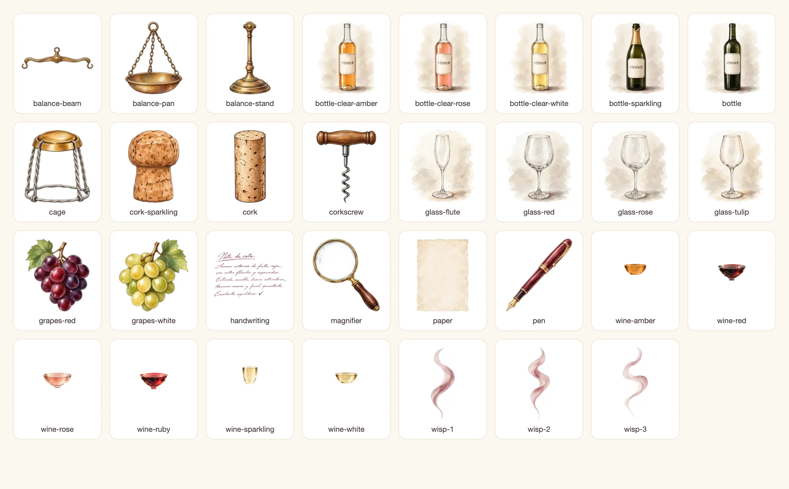

## Puntajes y sellos

### Copas, vino y botellas del puntaje

Capas de copa, vino y botella del puntaje con copas y del control para servir y
puntuar, elegidas por tipo de vino. Aparecen en el formulario y la lista de
reseñas y en las tarjetas de la cava.

- Web: `frontend-react/public/images/rating/`
- App: `frontend-mobile/assets/images/rating/`

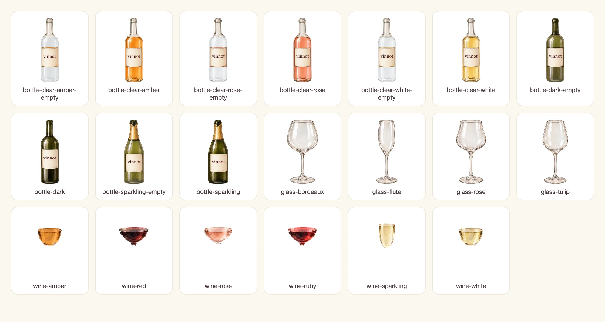

### Sellos de nivel

El sello de cada nivel de puntos: en la insignia del usuario en la web y en la
pantalla de puntos de la app.

- Web: `frontend-react/public/images/emblems/`
- App: `frontend-mobile/assets/images/emblems/`

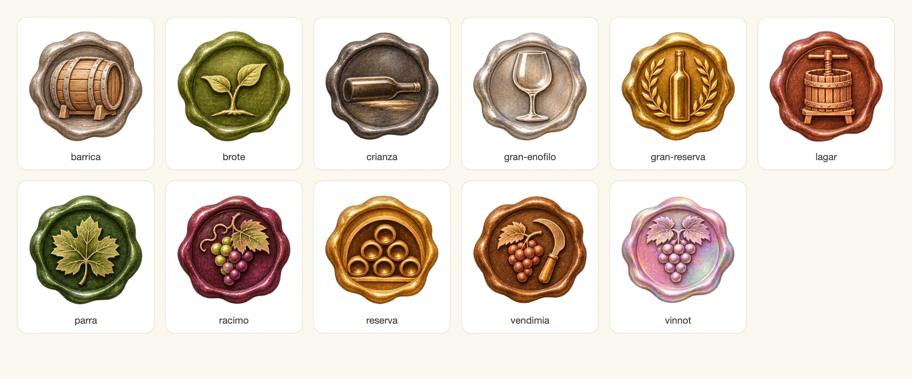

## Estados y portadas

### Ilustraciones de error, vacío y respaldo

Páginas de error (403, 404, 429, 500, 503, tiempo agotado, sin conexión),
estados vacíos (sin vinos, entradas, reseñas o notificaciones; cava vacía),
portadas de respaldo de eventos, bodegas y rutas, y las páginas legales, de
privacidad y de cookies. Los archivos son idénticos en las dos apps.

- Web: `frontend-react/src/shared/assets/illustrations/`
- App: `frontend-mobile/assets/images/illustrations/`

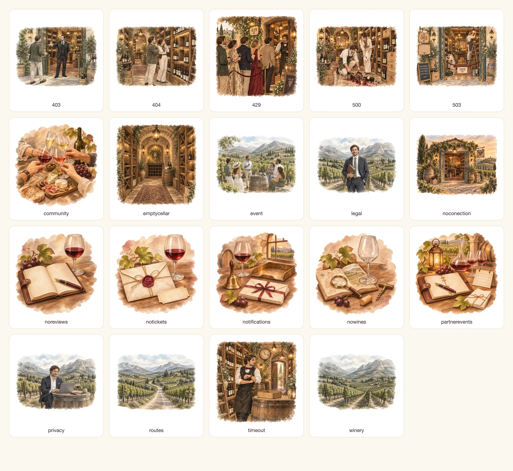

### Portadas de rutas

En la web, el detalle de una ruta sin imagen muestra una de estas fotos al
azar. La app usa la ilustración de rutas en su lugar.

- Web: `frontend-react/src/shared/assets/routes/`

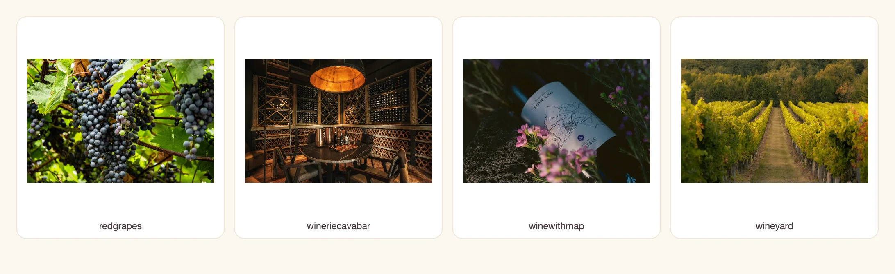

### Botella de respaldo

La botella que se muestra cuando un vino no tiene foto (oscura o clara según el
color del vino). También es la imagen de los datos simulados de la web.

- Web: `frontend-react/public/images/mock/`
- App: `frontend-mobile/assets/images/mock/`

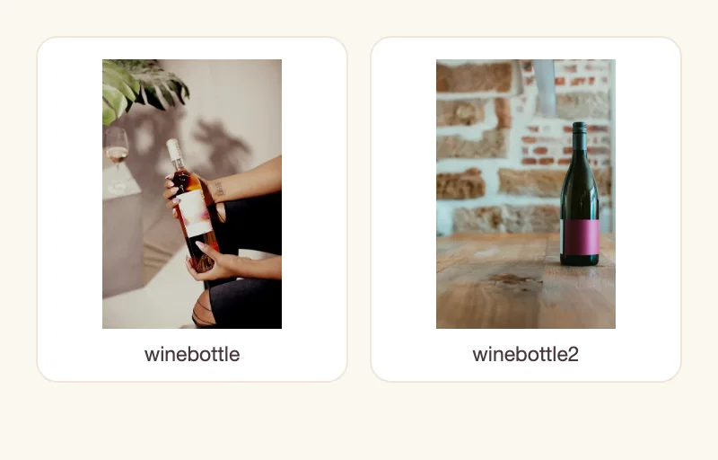

## Inicio y bienvenida

### Copas por tipo de vino

Accesos a tintos, blancos, rosados y espumantes en el inicio.

- Web: `frontend-react/src/shared/assets/glasses/`
- App: `frontend-mobile/assets/images/common/`

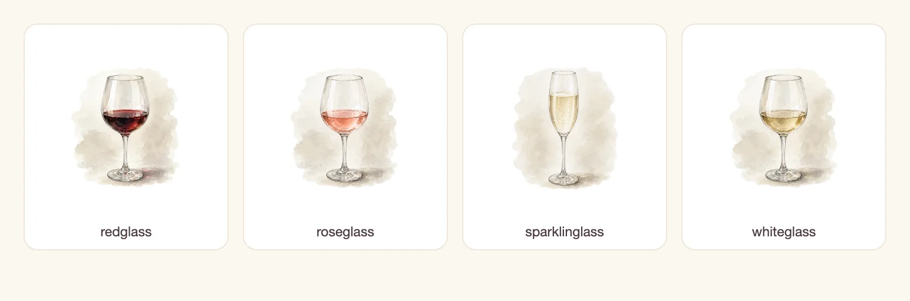

### Imagen principal del inicio

Arriba del inicio; en la web también en el panel editorial del ingreso. En la
web se llama `home-hero.webp` y se precarga en `index.html`; en la app es
`common/main.webp`.

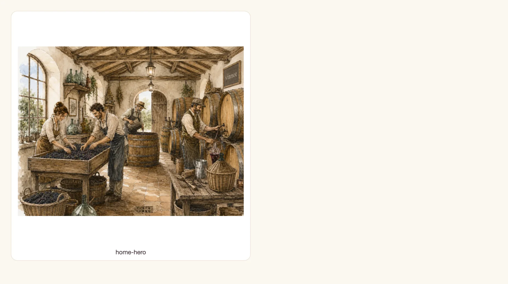

### Bienvenida de la app

Viñedo en acuarela de la pantalla de bienvenida del onboarding de la app.

- App: `frontend-mobile/assets/images/onboarding/vineyard.webp`

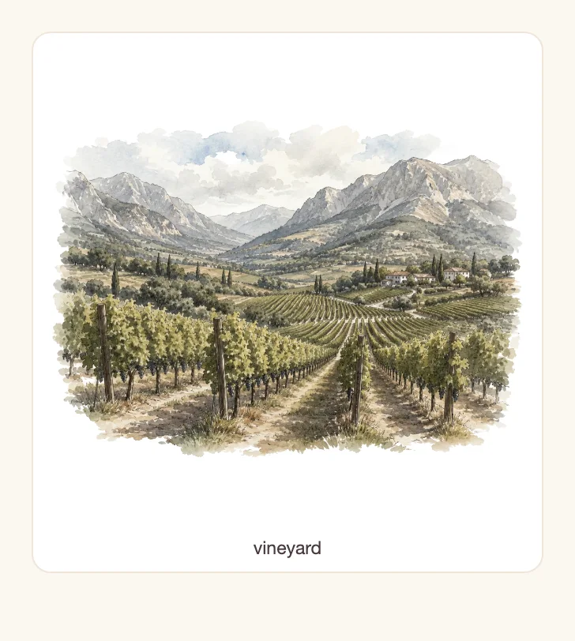

### Parches de redes sociales

Formas decorativas detrás de los enlaces a redes del pie de página de la web,
en rotación.

- Web: `frontend-react/src/shared/assets/social/`

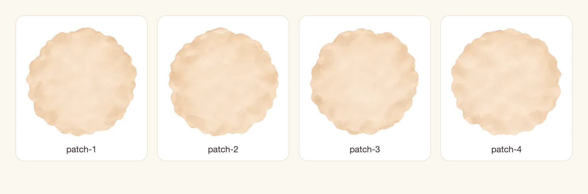

## Marca y canales externos

### Isotipo y logotipo

La copa de Vinnot y el logotipo en el encabezado y en la marca combinada, la
marca de carga con uvas, la pantalla de inicio de la app y la marca de agua de
la página de enlaces compartidos.

- Web: `frontend-react/public/images/brand/`
- App: `frontend-mobile/assets/brand/`

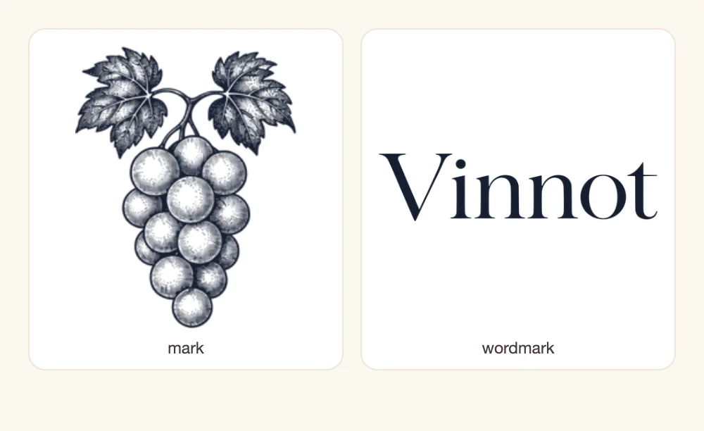

### Ícono y pantalla de inicio de la app

Ícono de la tienda y de la pantalla de inicio, primer plano del ícono adaptable
de Android, silueta de notificaciones de Android (blanca, se muestra sobre
fondo oscuro), pantalla de inicio nativa y favicon de la web de Expo. Los
configura `frontend-mobile/app.config.ts`.

- App: `frontend-mobile/assets/`

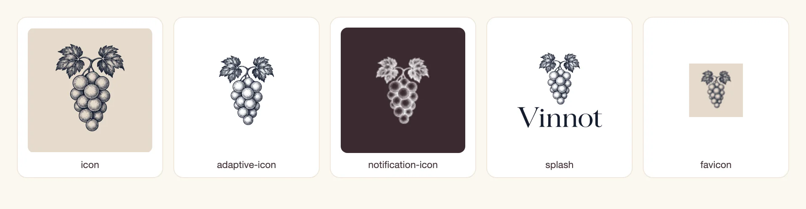

### Favicon de la web

`frontend-react/public/favicon.png` es el ícono de la pestaña y el de la vista
previa de notificaciones en administración.

### Correos

Imagen principal de todos los correos de marca (verificación, cambio de
contraseña, eventos, alta de vinos). Es PNG porque los clientes de correo no
muestran WebP de forma confiable. La usa el backend desde la web pública.

- Web: `frontend-react/public/images/email/winery-v1.png`

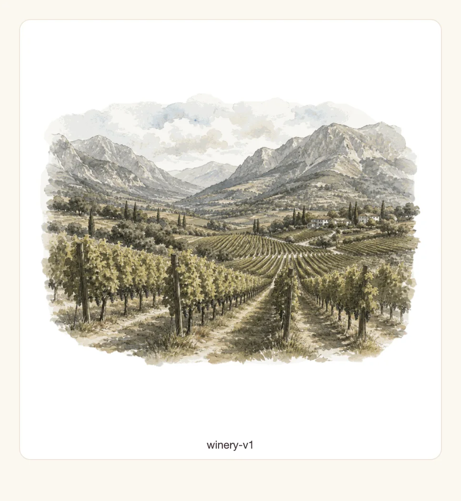

### Enlaces compartidos

Logo, insignias de las tiendas y vista previa de respaldo (Open Graph) de la
página que sirve el backend para los enlaces compartidos. Las insignias de las
tiendas también aparecen en la página de escaneo de etiquetas de la web.

- Web: `frontend-react/public/share-assets/`

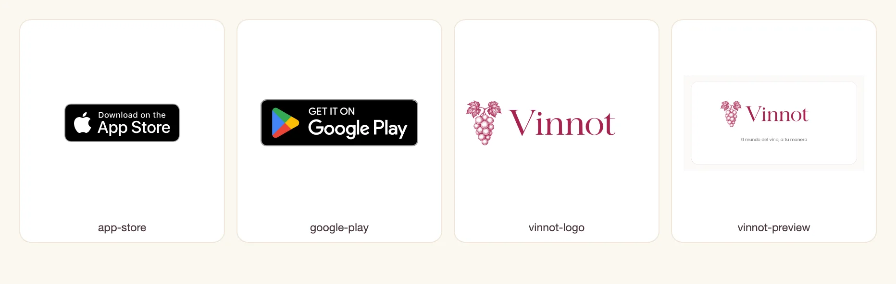

## Archivos fuente y sin uso

Estos archivos no se muestran en la app. No tienen lámina.

| Archivos | Estado |
|---|---|
| `frontend-mobile/assets/images/common/*.png` (19), `winery/*.jpg` (4), `mock/*.jpg` (2) | Originales: `scripts/optimize-static-artwork.py` genera a partir de ellos las ilustraciones, las portadas de rutas, las botellas de respaldo y la imagen de los correos. |
| `frontend-react/public/images/icons/`, `frontend-mobile/assets/images/icons/` (79 SVG de Reshot) | Sin uso en las dos apps. |
| `frontend-mobile/assets/images/illustrations/*.svg` (4 logos vectoriales) | Sin uso. |
| `frontend-mobile/assets/brand/splash.svg`, `adaptive-icon-foreground.svg` | Sin uso. |
| `frontend-react/public/favicon.svg`, `icons.svg` | Sin uso (restos de la plantilla de Vite). |
