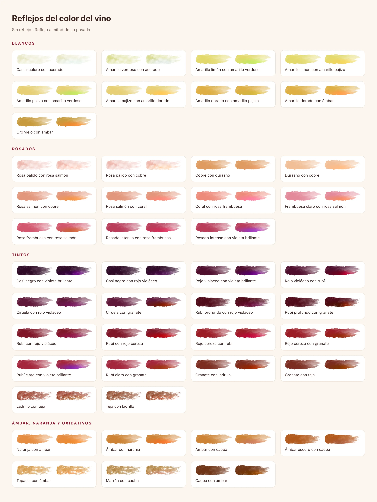
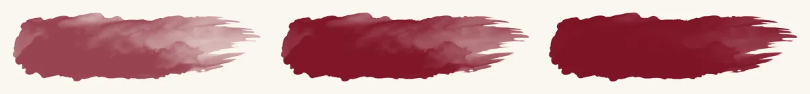

# Ilustración, marca e imágenes

El arte de Vinnot es **acuarela raster con fondo transparente**. Da el clima de
un estado o de una sección; la UI que lo rodea lleva la información. Esta
página cubre las reglas de ilustración, el pipeline de assets, los estados
ilustrados, las escenas de carga de IA y las marcas.

Parte del [sistema visual](visual-system.md).

## Reglas

| Hacer | Evitar |
|---|---|
| Usar las ilustraciones compartidas de `illustrations.ts` en cada plataforma | Importar en la UI los PNG maestros de `frontend-mobile/assets/images/common` |
| Mantener WebP transparente con las proporciones del maestro | Aplanar el arte sobre un rectángulo blanco o de color |
| Tratar el arte de estado como decorativo (`alt=""`, sin etiqueta accesible) y poner el significado en el título | Escribir texto dentro de una ilustración |
| Usar una ilustración por estado o pantalla vacía | Apilar ilustraciones o usarlas como decoración de listas |
| Mantener remotas las fotos del catálogo y de usuarios, detrás de `ImageWithFallback` | Empaquetar fotos del catálogo en la app o en el build web |

## Pipeline de assets

[`scripts/optimize-static-artwork.py`](../../../../scripts/optimize-static-artwork.py)
genera cada derivado empaquetado a partir de los maestros editables; `--check`
los verifica sin reescribirlos.

| Asset | Maestro | Derivado | Presupuesto verificado |
|---|---|---|---|
| 13 ilustraciones de estado y sección | `frontend-mobile/assets/images/common/<name>.png` (transparente) | `frontend-mobile/assets/images/illustrations/<name>.webp`, copia idéntica en `frontend-react/src/shared/assets/illustrations/` | WebP RGBA, lado mayor ≤ 960 px, < 260 kB, borde transparente, misma proporción que el maestro, bytes idénticos en web y app |
| Copas por categoría (tinto, blanco, rosado, espumoso) | `frontend-mobile/assets/images/common/*glass.webp` | copias idénticas en `frontend-react/src/shared/assets/glasses/` | — |
| Sellos (11 niveles) | arte aprobado en #455 | `frontend-mobile/assets/images/emblems/<slug>.webp` y `frontend-react/public/images/emblems/<slug>.webp` (`brote` … `vinnot`) | WebP transparente, 256 × 256 |
| Copas, vinos y botellas de la puntuación | arte aprobado en #455 | `frontend-mobile/assets/images/rating/` y `frontend-react/public/images/rating/`: `glass-{bordeaux,rose,tulip,flute}`, `wine-{red,ruby,rose,white,amber,sparkling}` (mismo lienzo que su copa), `bottle-{dark,clear-white,clear-rose,clear-amber,sparkling}` | WebP transparente de 360 px de alto |
| Fotos de rutas | `frontend-mobile/assets/images/winery/*.jpg` | `frontend-react/src/shared/assets/routes/*.webp`, 1280 × 960 | — |
| Hero de correo | `common/winery.png` | `frontend-react/public/images/email/winery-v1.png`, PNG indexado 720 × 540 | < 180 kB, transparente |

Consumidores:

- La web importa mediante [`src/shared/illustrations.ts`](../../../../frontend-react/src/shared/illustrations.ts);
  Vite emite URLs con hash de contenido que la CDN cachea como inmutables.
- La app importa mediante [`src/shared/illustrations.ts`](../../../../frontend-mobile/src/shared/illustrations.ts);
  Metro las empaqueta, así que los estados sin conexión y de error se muestran
  sin descarga.
- El correo usa PNG porque los clientes de correo no soportan WebP de forma
  uniforme. Se versiona el nombre del archivo cuando cambia el arte, se publican
  los assets web antes que el backend que los referencia y se conserva en el
  bucket el objeto anterior `/images/illustrations/winery.jpg` para los correos
  históricos.

Las 31 capas de carga de IA (`frontend-mobile/assets/images/loading/*.webp`)
no las genera el script. La web guarda copias idénticas byte a byte en
[`frontend-react/src/shared/assets/loading/`](../../../../frontend-react/src/shared/assets/loading);
se cambian ambas copias juntas.

## Catálogo de ilustraciones

| Clave | Archivo | Uso |
|---|---|---|
| `forbidden` | `403.webp` | estado 403 |
| `notFound` | `404.webp` | estado 404 y páginas no encontradas |
| `rateLimit` | `429.webp` | estado 429 |
| `server` | `500.webp` | error de servidor desconocido |
| `unavailable` | `503.webp` | estado 502 / 503 |
| `offline` | `noconection.webp` | error de red |
| `timeout` | `timeout.webp` | timeout / 504 |
| `emptyCellar` | `emptycellar.webp` | bodega vacía |
| `noWines` | `nowines.webp` | búsqueda de vinos sin resultados |
| `noTickets` | `notickets.webp` | todavía sin entradas |
| `noReviews` | `noreviews.webp` | todavía sin reseñas, invita a escribir la primera |
| `community` | `community.webp` | listas de comunidad vacías |
| `partnerEvents` | `partnerevents.webp` | organizador sin eventos todavía |
| `notifications` | `notifications.webp` | bandeja de notificaciones vacía |
| `event`, `route`, `winery`, `legal`, `privacy` | `event.webp`, `routes.webp`, `winery.webp`, `legal.webp`, `privacy.webp` | páginas de sección y legales |

## Estados ilustrados

`IllustratedState` muestra una ilustración, un título y una descripción para un
tipo de estado; `QueryErrorState` suma el reintento. Ambas plataformas
comparten la clasificación de `resolveIllustratedState`
([web](../../../../frontend-react/src/presentation/feedback/illustratedState.ts),
[app](../../../../frontend-mobile/src/presentation/feedback/illustratedState.ts)).
La web guarda los textos en `stateCopy`; la app los lee de los archivos de
idioma (`illustratedState.<tipo>.title` / `.description`, mediante
`illustratedStateCopyKeys`), así siguen el idioma de la app.

| Condición | Tipo | Ilustración | Reintento en `QueryErrorState` |
|---|---|---|---|
| HTTP 401 | `session` | ninguna | no |
| HTTP 403 | `forbidden` | 403 | no |
| HTTP 404 | `notFound` | 404 | no |
| HTTP 429 | `rateLimit` | 429 | sí |
| código `TIMEOUT` o HTTP 504 | `timeout` | timeout | sí |
| HTTP 502 o 503 | `unavailable` | 503 | sí |
| código `NETWORK_ERROR` | `offline` | sin conexión | sí |
| cualquier otro | `server` | 500 | sí |

El botón de reintento queda deshabilitado mientras el error tenga un `retryAt`
futuro (`useRetryDeadline`).

Tamaños: en la web el arte mide `max-h-40` en modo compacto y
`max-h-64 sm:max-h-72` completo, dentro de una columna `max-w-2xl`; en la app,
150 pt compacto y 240 pt completo, dentro de una columna de 640 pt. El modo
compacto es para un bloque que falla dentro de una página; el completo, para
una ruta entera.

Las listas vacías de la web usan `EmptyState illustration="<clave>"` (arte
`h-40 sm:h-48`, decorativo): búsqueda de vinos `noWines`, reseñas `noReviews`,
mis entradas `noTickets`, eventos del organizador `partnerEvents`, listas de
comunidad `community`, eventos `event`, rutas `route`, bodegas `winery`, bodega
personal `emptyCellar`.

Las listas vacías de la app usan `EmptyState illustration="<clave>"` (arte de
180 pt de alto, `contentFit="contain"`, decorativo y oculto para lectores de
pantalla; el título es un encabezado). Reemplaza el círculo del ícono: búsqueda
de vinos, vinos de una bodega y detalle del vino `noWines` (`server` cuando la
búsqueda falla), bodega personal `emptyCellar`, reseñas `noReviews`, mis
entradas `noTickets`, eventos y detalle de evento `event`, rutas y detalle de
ruta `route`, bodegas `winery`, eventos del organizador `partnerEvents`, listas
de comunidad y moderación `community`, historial de notificaciones
`notifications`. Todas las ilustraciones tienen fondo transparente, así quedan
sobre el color de la pantalla sin un recuadro blanco.

## Pincelada de color del vino

El análisis visual del perfil de IA muestra una pincelada de acuarela con el
color que describe el texto: el color principal en el cuerpo del trazo y el
color del borde hacia la punta, como se ve el vino en una copa inclinada sobre
fondo blanco. La línea de color es texto libre escrito para cada vino
(profile-v13 varía su redacción y su arranque), y el backend la lee en códigos:

- `visualColorTone`: el tono principal. Una línea que abre con el tono lo toma
  del texto antes de la primera coma o de «con»: «amarillo pálido con reflejos
  verdosos» es pajizo con reflejo verde. Una línea que abre con la luz, la copa,
  las lágrimas o el borde («Un ribete violeta brillante enmarca un centro casi
  negro») lo toma de la primera cláusula sobre el centro o, si no hay, de la
  primera cláusula con tono que no hable del borde ni de los reflejos.
- `visualColorIntensity`: qué tan profundo se ve el centro, `PALE`, `MEDIUM` o
  `DEEP`, leído del tono principal o de la cláusula que le sigue. Vale cualquier
  forma natural: pálido, claro, ligero, translúcido, acuoso, «deja ver el fondo
  de la copa»; medio, «capa media»; profundo, intenso, oscuro, opaco, casi
  negro, «capa alta», «no deja ver el fondo». Los pasos mixtos van hacia su lado
  («media-baja» es pálido, «medium-high» es profundo). Es nulo si el centro no
  nombra profundidad; la pincelada conserva entonces su trazo base.
- `visualRimTone`: el primer matiz posterior que nombra otro tono de la misma
  familia de vino («con reflejos teja en los bordes»). Un tono que la línea le da
  al centro no es el borde: en «amarillo pajizo con un centro algo más dorado
  que el borde, reflejos limón» el borde es limón, no dorado. Si no hay, el
  borde es el mismo color, más diluido.
- `visualReflectionTones`: todos los tonos que nombran los matices, en el orden
  del texto («con reflejos violáceos y matices teja» → violáceo, luego teja).
  El cobrizo es teja en los tintos y los ámbar, ámbar en los blancos y rosa
  cobrizo en los rosados.
- `visualHighlights`: si la línea nombra un juego de luz (reflejos, destellos,
  ribete, brillo, matices).

La pincelada va del tono principal en el cuerpo al tono del borde en la punta.
Cuando la línea nombra reflejos, un lavado suave del color del reflejo recorre
el borde inferior de la pincelada de izquierda a derecha, como el borde del vino
que toma ese tono al inclinar la copa; si nombra varios («reflejos violáceos y
matices teja»), cada pasada muestra el siguiente, uno cada 4,2 s, después de los
0,9 s en que se pinta la pincelada. El lavado tiñe el tono y conserva el sombreado
de la acuarela, así que también se ve en los blancos y rosados claros; el violáceo
se pinta un poco más claro, con luz suave, para que se lea como el violeta del
vino y no como pintura. Si la línea sólo nombra brillo sin otro tono, el lavado
es el mismo tono, más claro. Con «reducir movimiento» el lavado queda quieto en
el medio de la pincelada.

Cada combinación que aparece hoy en los perfiles, con la pincelada sin reflejo
y con el reflejo a mitad de su pasada:

Si la línea no nombra un tono, no se muestra la pincelada y queda sólo el texto.
Un tono negado («sin tonos teja», «sin oro viejo») no se pinta. Si la línea
abre con adjetivos sin tono («Profundo, casi opaco, centro púrpura…»), el tono
principal es el primero que nombra. Translúcido aclara el tono salvo que la
línea diga intensidad media; picota y cereza oscura son rubí profundo. Un rosa
frambuesa o frutilla claro o pálido («rosa frambuesa claro», «rosa frutilla muy
pálido») es frambuesa claro, no el frambuesa pleno. El oro viejo es su propio
dorado, más profundo y amarronado, en el centro o en el borde. Castaño se pinta
caoba en los ámbar y teja en los tintos; magenta se pinta violáceo en los
tintos y frambuesa en los rosados.

El lugar, la edad y la elaboración traen matices más finos, cada uno con su
tono: tintos casi negros, de tinta, por la altura o el Tannat; un violeta joven y
brillante (distinto del púrpura oscuro); ciruela; ladrillo en los tintos viejos
(más rojo que la teja); blancos casi incoloros y acerados de clima frío; topacio
en los blancos dulces evolucionados; marrón en los blancos viejos y los
generosos (más claro que la caoba, que conserva el Pedro Ximénez); los vinos
naranjos de maceración con pieles y el ámbar oscuro; y los rosados cobrizos,
coral, durazno e intensos. La cereza negra sigue siendo rubí profundo y la cereza,
cereza; un «rosa cereza claro» es un rosado intenso.

| Código | Tono | Ejemplo de texto |
| --- | --- | --- |
| `WHITE_WATER` | Casi incoloro, acuoso | Casi incoloro, con destellos verdosos acuosos |
| `WHITE_STEEL` | Verdoso acerado o plateado | Amarillo verdoso acerado, con reflejos plateados |
| `WHITE_GREEN` | Amarillo pálido verdoso | Amarillo verdoso pálido |
| `WHITE_LEMON` | Amarillo limón | Amarillo limón pálido con destellos verdosos |
| `WHITE_STRAW` | Amarillo pajizo | Amarillo pajizo con reflejos verdosos |
| `WHITE_GOLD` | Amarillo dorado | Amarillo dorado intenso |
| `WHITE_OLD_GOLD` | Oro viejo | Oro viejo intenso, con reflejos ámbar |
| `WHITE_TOPAZ` | Topacio, blancos dulces o de cosecha tardía evolucionados | Dorado topacio intenso con borde ámbar |
| `ORANGE` | Naranja, vinos de maceración con pieles | Ámbar anaranjado, levemente turbio, con borde dorado |
| `AMBER` | Ámbar | Dorado cobrizo con reflejos ámbar |
| `AMBER_DARK` | Ámbar oscuro | Ámbar oscuro, con reflejos caoba |
| `WHITE_BROWN` | Marrón, blancos viejos y generosos | Castaño claro, con ribete dorado |
| `MAHOGANY` | Caoba o ébano | Caoba oscuro con ribete ámbar verdoso |
| `ROSE_PALE` | Rosa pálido | Rosa pálido con destellos brillantes |
| `ROSE_COPPER` | Cobrizo o piel de cebolla | Rosa piel de cebolla con reflejos cobrizos |
| `ROSE_SALMON` | Salmón | Salmón pálido con reflejos cobrizos |
| `ROSE_PEACH` | Durazno, melocotón o damasco | Rosa durazno pálido, con borde melocotón |
| `ROSE_CORAL` | Coral | Coral brillante con reflejos salmón |
| `ROSE_RASPBERRY_LIGHT` | Rosa frambuesa o frutilla claro o pálido | Rosa frambuesa claro con borde salmón |
| `ROSE_RASPBERRY` | Rosa frambuesa, fresa o cereza | Rosa frambuesa de intensidad media |
| `ROSE_DEEP` | Rosado intenso o clarete | Rosado intenso con reflejos violáceos |
| `RED_VIOLET_BRIGHT` | Violeta joven y brillante | Violeta brillante y vivaz, con borde magenta |
| `RED_PURPLE` | Rojo violáceo | Rojo violáceo profundo |
| `RED_INKY` | Casi negro, de tinta | Negro violáceo, con ribete violeta brillante |
| `RED_PLUM` | Ciruela | Rojo ciruela profundo, con borde rubí |
| `RED_RUBY_LIGHT` | Rubí claro | Rojo rubí claro |
| `RED_CHERRY` | Rojo cereza | Rojo cereza de intensidad media con borde rubí |
| `RED_RUBY` | Rubí medio | Rojo rubí de intensidad media |
| `RED_RUBY_DEEP` | Rubí profundo, picota o cereza oscura | Rojo rubí profundo con reflejos violáceos |
| `RED_GARNET` | Granate | Rojo granate con ribete anaranjado |
| `RED_BRICK` | Ladrillo, tintos viejos anaranjados | Rojo ladrillo con borde anaranjado |
| `RED_TAWNY` | Teja | Rojo teja con ribete ocre |

La pincelada es una máscara de acuarela (720 × 208 px, blanco con transparencia
según la densidad del pigmento) sobre un degradé del color principal al del
borde. Todos los vinos usan la misma forma de pincelada; `strokeFor` en
`shared/wineColorPalette.ts` elige cuánto pigmento lleva. Las máscaras liviana y
cargada son la máscara base con menos o más pigmento, así las tres cubren
exactamente el mismo contorno:

| Carga | Archivo | Cuándo |
| --- | --- | --- |
| Liviana: una aguada transparente | `wine-colors/stroke-light.webp` | `PALE`; sin profundidad nombrada, `WHITE_WATER`, `WHITE_STEEL`, `WHITE_GREEN` y `ROSE_PALE` |
| Media | `wine-colors/stroke.webp` | `MEDIUM`, y todo otro tono sin profundidad nombrada |
| Cargada: un trazo denso, casi opaco | `wine-colors/stroke-dense.webp` | `DEEP`; sin profundidad nombrada, `RED_INKY`, `RED_RUBY_DEEP`, `MAHOGANY` y `AMBER_DARK` |

 Cada código tiene un pigmento y un
destello de reflejo fijos en `shared/wineColorPalette.ts`, iguales en web y app;
su orden de matices sigue la tabla de color del vino de Wine Folly, con la
saturación y la luminosidad ajustadas para leerse sobre las tarjetas crema (el
granate tira a naranja, la tinta es un violeta muy oscuro, el marrón queda entre
el ámbar y la caoba). En la web es una máscara CSS;
en la app, una máscara alfa de Skia. Al aparecer, el trazo se pinta de
izquierda a derecha en 0,9 s, salvo que el sistema pida reducir el movimiento.
Se muestra a 240 px de ancho en la web y 220 pt en la app, y su texto
alternativo es la línea de color.

## Ilustraciones del perfil de IA

Cada sección del perfil de IA tiene su propia ilustración en acuarela, sin
papel de fondo, para que al rotar cambie sólo el objeto y no la tarjeta:

- **Perfil aromático:** los aromas primarios y secundarios aparecen de a uno en
  el mismo lugar (frambuesa, hierbas secas, pimienta negra…), cada 4,5 s, con
  un fundido suave: la que sale desaparece antes de que aparezca la siguiente,
  y el nombre del aroma debajo.
- **Sabores:** lo mismo con los sabores primarios y secundarios. Las barras de
  estructura en boca se llenan desde cero al aparecer.
- **Maridajes:** los platos rotan igual (cordero, pollo asado, risotto…).
- **Servicio:** cada caja muestra su ilustración arriba y debajo el título y el
  texto, centrados: el termómetro que sube hasta la temperatura recomendada
  (escala de 0 a 25 °C), la copa sugerida, el decantador cuando conviene
  decantar y la cava cuando hay potencial de guarda.

El backend clasifica los textos del perfil y envía `profileArt` con un código por
ilustración (ver [Arquitectura de IA](../../modules/ai/architecture.md)). Un
descriptor sin código no muestra dibujo; nunca uno equivocado. La ilustración
tiene que mostrar lo que dice el texto, con sus calificativos: «pimiento rojo
asado» muestra tiras de pimiento rojo asado y no un pimiento verde, «damasco» un
damasco y no un durazno, y un risotto de calabaza no muestra hongos. En los
platos manda la forma del plato (pizza, empanada, paté, arroz, risotto, curry,
tarta, pasta) sobre el relleno: «empanada de cordero» es una empanada. Un plato
sin ilustración fiel (cheesecake, ensalada de frutas) no muestra nada.
Una uva roja, negra o de una cepa tinta («uva roja», «uva Corvina», «ripe
Barbera grape») es una uva tinta, nunca la verde; la cereza negra u oscura es una
cereza casi negra, la pimienta blanca no es pimienta negra, y un pastel de carne,
una tortilla, una milanesa o un ciervo son su propio plato, no el bife o el
cordero que nombra su relleno. Un melón blanco o rocío de miel no es el melón
naranja, y un queso de cabra con su estacionamiento o su leche en el medio
(«queso semiduro de cabra») es queso de cabra.
Las ilustraciones son decorativas: el texto ya nombra cada aroma, sabor y plato,
así que quedan ocultas para lectores de pantalla.

Los clientes listan sólo los códigos con un dibujo incluido y descartan cualquier
otro, así que un descriptor no muestra dibujo antes que uno equivocado. Un código
nuevo necesita su arte en `profile-art/` y su clave en `wine.profile-art.ts` en
cada plataforma (y la importación estática en `profileArt.ts` de mobile).

Hay 69 notas (frutas, flores, hierbas, especias, tierra, roble, dulces y una
fruta mixta para «frutas» genérico), 35 platos (incluye hongos y aceitunas) y
12 piezas de servicio: 9 copas (flauta, tulipa de espumoso, balón de tinto,
Bordeaux, tulipa de blanco, blanco de cáliz amplio, rosado, postre o
fortificado y universal de cata), el decantador, una botella recién descorchada
(cuando no hace falta decantar) y la cava, en `profile-art/{notes,dishes,serving}/` como WebP transparente de 192 px.
Se muestran a 96 px en la web y 88 pt en la app. Con «reducir movimiento» no hay
rotación ni animaciones: se ve una fila quieta de hasta 4 ilustraciones en la
web y 3 en la app, y el termómetro y las barras aparecen ya llenos.

## Redes sociales

El footer de la web enlaza los perfiles oficiales de Vinnot en Instagram,
Facebook, Threads y TikTok (`shared/config/socialProfiles.ts`). Cada logo
oficial se dibuja sin modificar, en el color vino del texto, sobre un parche
crema ilustrado con el mismo estilo de acuarela. Los enlaces abren en una
pestaña nueva y su nombre accesible es «Vinnot en <red>».

## Escenas de carga de IA

Aplica a la web y a la app. Mientras se genera un perfil de vino con IA o una
comparación, ambas reproducen un recorrido en acuarela en lugar de un spinner.
Los archivos de la app:

| Parte | Archivo |
|---|---|
| Card, encabezado, contador y lista de pasos | [`WineProcessJourney.tsx`](../../../../frontend-mobile/src/presentation/features/wine/WineProcessJourney.tsx) |
| Anillo de progreso (176 pt) y tiempos de escena | [`WineProcessScene.tsx`](../../../../frontend-mobile/src/presentation/features/wine/WineProcessScene.tsx) |
| Capas de acuarela sobre un escenario de 128 pt | [`WineProcessSceneArt.tsx`](../../../../frontend-mobile/src/presentation/features/wine/WineProcessSceneArt.tsx) |
| Aspecto según el tipo de vino | [`wineSceneLook.ts`](../../../../frontend-mobile/src/presentation/features/wine/wineSceneLook.ts) |
| Intervalos por etapa y duración mínima | [`wineProcessTiming.ts`](../../../../frontend-mobile/src/presentation/features/wine/wineProcessTiming.ts) |
| Visibilidad después de la respuesta | [`useProcessJourneyVisibility.ts`](../../../../frontend-mobile/src/presentation/hooks/useProcessJourneyVisibility.ts) |

Archivos web, un solo componente compartido que usan `AiProfileLoadingSteps` y
`CompareLoadingSteps`:

| Parte | Archivo |
|---|---|
| Card, antetítulo, título, anillo, paso actual y lista de pasos | [`AiProcessScene.tsx`](../../../../frontend-react/src/presentation/components/features/wine/aiProcess/AiProcessScene.tsx) |
| Capas de escena, recorridos de movimiento, aspecto según el tipo de vino | [`aiProcessScenes.ts`](../../../../frontend-react/src/presentation/components/features/wine/aiProcess/aiProcessScenes.ts) |
| Dibujo y keyframes CSS por parte | [`AiProcessSceneArt.tsx`](../../../../frontend-react/src/presentation/components/features/wine/aiProcess/AiProcessSceneArt.tsx) |

La web porta la composición de la app: las mismas capas sobre un escenario de
128 px dentro de un anillo de 176 px, los mismos gestos. El movimiento de cada
parte se muestrea en `@keyframes` CSS, así cada parte (corcho, sacacorchos,
chorro, nivel del vino, aromas, pluma, balanza, lupa, burbujas) se mueve por
separado.

Escenas:

- Perfil de IA: `uncork`, `visual`, `bouquet`, `taste`, `report`.
- Comparación: `compare`, `structure`, `contrast`, `recommendation`. La
  comparación web tiene cinco pasos (claves `compare.steps.*`): `uncork`,
  `compare`, `structure`, `contrast`, `recommendation`.

Las escenas siguen el tipo de vino, leído del código de la API sin importar
mayúsculas (`ROSE` y `rose` son el mismo vino); en una comparación cada copa
sigue a su propio vino:

| Tipo de vino | Copa | Vino | Botella | Uvas |
|---|---|---|---|---|
| tinto (predeterminado mientras no se conoce el tipo) | bordeaux | tinto | oscura | tintas |
| fortificado | bordeaux | rubí | oscura | tintas |
| rosado | rosé | rosado | transparente | tintas |
| blanco | tulipa | blanco | transparente | blancas |
| naranjo, dulce | tulipa | ámbar | transparente | blancas |
| espumoso | flauta | espumoso | espumosa (salta el corcho) | blancas |

Reglas de tiempo:

- Una etapa del perfil dura 1,8 s en pantalla; una de la comparación, 2,5 s en
  la app y 2,2 s en la web (cinco pasos). La última etapa dura al menos 3,2 s
  en la app.
- Con una respuesta exitosa, el recorrido sigue visible hasta su duración mínima
  (10,4 s para el perfil, 10,7 s para la comparación) para que se lea cada
  etapa. Un fallo lo oculta de inmediato (`cancel`). La web muestra el
  recorrido mientras la solicitud está pendiente y no tiene duración mínima.
- Mientras la respuesta está pendiente en el último paso, `report` y
  `recommendation` repiten su gesto después de una pausa.
- Con movimiento reducido, cada escena muestra su pose final y el anillo salta
  al paso actual (web: `useReducedMotion`, que sigue los cambios en vivo).
- La card es un `progressbar` con el título y el paso actual como etiqueta y el
  número de paso como valor (web: `aria-valuetext` "02 / 05 · paso").

## Marcas

| Marca | Web | App |
|---|---|---|
| Racimo + logotipo | [`VinnotBrand.tsx`](../../../../frontend-react/src/presentation/components/brand/VinnotBrand.tsx): PNG de `public/images/brand/` usados como máscaras CSS teñidas con `currentColor` | [`VinnotBrand.tsx`](../../../../frontend-mobile/src/presentation/features/auth/VinnotBrand.tsx): `assets/brand/mark.png` y `wordmark.png` |
| Proporciones | racimo 338 : 431, logotipo 702 : 171 | iguales |
| Marca de carga | [`GrapeLoadingMark.tsx`](../../../../frontend-react/src/presentation/components/brand/GrapeLoadingMark.tsx), usada por `Spinner size="lg"` | [`WineGlassMark.tsx`](../../../../frontend-mobile/src/presentation/components/brand/WineGlassMark.tsx) con `animated`, usada por la pantalla de inicio y los resultados de vinos |

La marca de carga pinta las uvas de abajo hacia arriba en un ciclo de 3,4 s,
mantiene el color completo y se desvanece antes de repetir. Es decorativa,
nunca mide el progreso de una petición, y solo corre mientras algo carga;
headers, footers e íconos instalados quedan estáticos. Con movimiento reducido
se muestra la marca completa y estática. Los íconos del launcher y el splash
nativo no pueden ejecutarla.

Los maestros SVG entregados por el dueño se conservan intactos
(`frontend-mobile/assets/brand/*.svg`).

## Fotos

Las imágenes del catálogo, bodegas, eventos y usuarios son remotas. Se muestran
con `ImageWithFallback`
([web](../../../../frontend-react/src/presentation/components/ui/ImageWithFallback.tsx),
[app](../../../../frontend-mobile/src/presentation/components/ui/ImageWithFallback.tsx)):
el fallback conserva el tamaño del marco para que el layout no salte. La web
muestra una imagen de reemplazo y, si también falla, una superficie wine-50; la
app muestra una superficie con tinte borgoña.

## Correo transaccional

El backend aplica una sola plantilla,
[`branded-message.html`](../../../../backend/src/main/resources/email/branded-message.html):
banner borgoña, logo PNG, arte de viñedo, título editorial, texto de sistema y
un footer informativo. El texto y las acciones nunca dependen de imágenes ni de
CSS avanzado. Ver [cuenta y perfil](../../modules/users/architecture.md#presentación-de-correos-transaccionales)
para el contrato, los idiomas y las previews locales.
