# Catálogo de movimiento

Cada animación de la web (`frontend-react`) y de la app (`frontend-mobile`),
agrupada por propósito: qué se mueve, dónde, qué la inicia, cuánto dura, qué
ocurre con movimiento reducido y dónde está el código. Las vistas previas son
grabaciones de los componentes web reales; cuando una animación es compartida,
la grabación web representa a las dos plataformas y la entrada indica los
tiempos propios de la app cuando difieren. Los [fundamentos](foundations.md#movimiento)
conservan los principios y los tokens de movimiento.

Parte del [sistema visual](visual-system.md).

## Principios

1. **El movimiento explica un cambio de estado.** Muestra que algo carga,
   llegó, se fue o cambió de valor. Nunca simula progreso ni finalización: los
   indicadores de carga son ciclos decorativos, nunca un porcentaje.
2. **Breve en los controles, sereno en el contenido.** Los controles responden
   en 110–240 ms; las entradas de contenido duran 300–1000 ms; los loops
   decorativos duran segundos.
3. **Un solo vocabulario de movimiento en las dos plataformas.** Una animación
   compartida mantiene sus tiempos en la web y en la app, salvo que la
   plataforma imponga los suyos (stacks nativos, `Modal`, `ActivityIndicator`).
4. **Se respeta el movimiento reducido.** Con el ajuste del sistema activo, el
   movimiento se detiene y cada elemento muestra su estado final. La única
   excepción es el `ActivityIndicator` de la app: igual que los indicadores de
   actividad de Apple, sigue girando porque es un indicador de progreso
   esencial.

## Tokens

| Plataforma | Dónde | Qué define |
|---|---|---|
| Web | [`globals.css`](../../../../frontend-react/src/shared/assets/styles/globals.css) | `transition-default` (150 ms, `cubic-bezier(0.4, 0, 0.2, 1)`) y cada keyframe compartido (marca de uvas, pincelada del color del vino, arte del perfil, termómetro, barras del paladar) |
| Web | Utilidades de Tailwind | `duration-*`, `ease-*`, `animate-pulse` (2 s), `animate-spin` (1 s) y la variante `motion-reduce:` |
| App | [`motion.ts`](../../../../frontend-mobile/src/shared/theme/motion.ts) | `durations`, `easings`, `motionPresets`, `springConfigs` (detallados en los [fundamentos](foundations.md#movimiento)) |

Cómo leer las tablas: **Plataforma** indica dónde se ejecuta la animación (Web,
App o Ambas); **Movimiento reducido** describe lo que ve la persona cuando el
sistema pide menos movimiento. En la app, Reanimated 4 sigue ese ajuste de
forma predeterminada (`ReduceMotion.System`): las animaciones de entrada y los
valores con `withTiming` o `withSpring` saltan a su estado final. Las filas
dicen "predeterminado de Reanimated" para ese caso.

## 1. Carga y skeletons

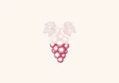

*L1 Marca de uvas que se pinta.*

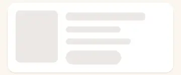

*L2 Skeleton.*

| # | Animación | Plataforma | Dónde y disparador | Duración y curva | Movimiento reducido | Código |
|---|---|---|---|---|---|---|
| L1 | Marca de uvas que se pinta | Ambas | `PageLoader` y `Spinner size="lg"` (web), `WineGlassMark` (app), mientras carga una página o un bloque grande | Web: loop de 3,4 s `linear`; un recorte revela la marca desde la base hasta las hojas, se sostiene y se desvanece. App: loop de 3400 ms `linear`, mismo ciclo | Marca completa y estática | [`GrapeLoadingMark.tsx`](../../../../frontend-react/src/presentation/components/brand/GrapeLoadingMark.tsx), [`globals.css`](../../../../frontend-react/src/shared/assets/styles/globals.css), [`WineGlassMark.tsx`](../../../../frontend-mobile/src/presentation/components/brand/WineGlassMark.tsx) (copia en [`features/auth`](../../../../frontend-mobile/src/presentation/features/auth/WineGlassMark.tsx)) |
| L2 | Skeleton | Ambas | Marcadores `Skeleton` mientras carga una lista o una tarjeta | Web: `animate-pulse`, loop de 2 s. App: loop de opacidad de 1200 ms (600 ms en cada sentido, ease-in-out predeterminado de `Animated`) | Bloque quieto. La app lee el ajuste una vez, al montar el skeleton | [`Skeleton.tsx`](../../../../frontend-react/src/presentation/components/ui/Skeleton.tsx), [`Feedback.tsx`](../../../../frontend-mobile/src/presentation/components/ui/Feedback.tsx) |
| L3 | Spinners chicos | Ambas | Web: `Button` en carga, `Spinner` `sm`/`md`, `EntityPicker`, el geocodificador de rutas del panel de administración y la etiqueta del paso de IA. App: `ActivityIndicator` | Web: `animate-spin`, 1 s `linear`. App: indicador nativo | Web: se detiene (`motion-reduce:animate-none`). App: sigue girando, como indicador de progreso esencial | [`Button.tsx`](../../../../frontend-react/src/presentation/components/ui/Button.tsx), [`Spinner.tsx`](../../../../frontend-react/src/presentation/components/ui/Spinner.tsx), [`EntityPicker.tsx`](../../../../frontend-react/src/presentation/components/ui/EntityPicker.tsx), [`AdminRouteStopsSection.tsx`](../../../../frontend-react/src/presentation/components/features/admin/route-form/AdminRouteStopsSection.tsx), [`AiProcessScene.tsx`](../../../../frontend-react/src/presentation/components/features/wine/aiProcess/AiProcessScene.tsx) |
| L4 | Marcador de imagen de portada | Web | `CoverImage` mientras su fuente está pendiente | `animate-pulse`, loop de 2 s | Quieto | [`CoverImage.tsx`](../../../../frontend-react/src/presentation/components/features/media/CoverImage.tsx) |
| L5 | Tarjetas del panel de administración | Web | Tarjetas de métricas mientras carga el panel | `animate-pulse`, loop de 2 s | Quietas | [`AdminDashboardPage.tsx`](../../../../frontend-react/src/presentation/pages/admin/AdminDashboardPage.tsx) |
| L6 | Insignia "Quedan pocas" | Web | Hero del detalle de evento cuando quedan pocas entradas | `animate-pulse`, loop de 2 s | Quieta | [`EventDetailsHero.tsx`](../../../../frontend-react/src/presentation/pages/events/EventDetailsHero.tsx) |

## 2. Feedback

*F1 Aviso y toast.*

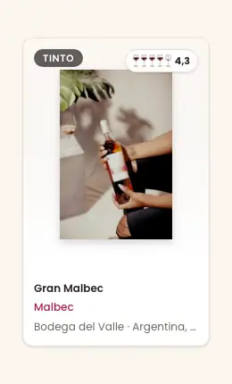

*F8 Hover en tarjetas.*

*F9 Celebración de nivel.*

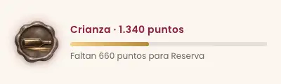

*F10 Brillo de la barra de puntos.*

| # | Animación | Plataforma | Dónde y disparador | Duración y curva | Movimiento reducido | Código |
|---|---|---|---|---|---|---|
| F1 | Aviso y toast | Ambas | Aparece un toast después de una acción; avisos en línea (`AlertBanner`) al montarse | Entrada 240 ms, `translateY -8 → 0` con fundido. Salida 180 ms, `translateY → -4` con fundido. Web: entrada `cubic-bezier(.2,.7,.3,1)`, salida `ease-in`. App: mismos tiempos, desplazamiento con `Easing.out(cubic)` en ambos sentidos | Aparece y se va sin desplazamiento. La app sigue los cambios del ajuste en vivo | [`feedback.css`](../../../../frontend-react/src/presentation/components/feedback/feedback.css), [`ToastContainer.tsx`](../../../../frontend-react/src/presentation/components/feedback/ToastContainer.tsx), [`ToastProvider.tsx`](../../../../frontend-mobile/src/presentation/providers/ToastProvider.tsx) |
| F2 | Transiciones de controles | Web | Cambios de color, borde y sombra en hover y foco: `Button`, campos, `Pagination`, el botón de cierre del aviso | 150 ms; `transition-default` y la curva predeterminada de Tailwind `cubic-bezier(0.4, 0, 0.2, 1)`; el botón de cierre del aviso usa `ease` | Sin cambios: cambian colores, nada se mueve (el botón de cierre del aviso quita su transición) | [`globals.css`](../../../../frontend-react/src/shared/assets/styles/globals.css), [`buttonStyles.ts`](../../../../frontend-react/src/presentation/components/ui/buttonStyles.ts) |
| F3 | Escala al presionar | App | `Button` escala a 0,96 y `PressableCard` a 0,98 al presionar; vuelven a 1 al soltar | 120 ms (`motionPresets.*.duration`), curva predeterminada de Reanimated; `Button` suma un háptico de impacto y `PressableCard` uno de selección | Predeterminado de Reanimated: sin escala; los hápticos se mantienen | [`Button.tsx`](../../../../frontend-mobile/src/presentation/components/ui/Button.tsx), [`Card.tsx`](../../../../frontend-mobile/src/presentation/components/ui/Card.tsx) |
| F4 | Presión con resorte | App | `MotionPressable` (tarjetas del inicio, rutas del vino, filas de usuarios del panel) escala a 0,975 | Resorte: damping 18, stiffness 260, mass 0,7 | Predeterminado de Reanimated: sin escala | [`MotionPressable.tsx`](../../../../frontend-mobile/src/presentation/components/ui/MotionPressable.tsx) |
| F5 | Brillo de foco en campos | App | Brillo y borde de `TextField` al enfocar y desenfocar | Foco 200 ms, desenfoque 150 ms, curva predeterminada de Reanimated | Predeterminado de Reanimated: el brillo aparece sin fundido | [`TextField.tsx`](../../../../frontend-mobile/src/presentation/components/ui/TextField.tsx) |
| F6 | Lista del campo de cosecha | App | En `VintageField` el chevron gira y la lista de opciones aparece con fundido al abrir | Chevron 180 ms; lista entra en 160 ms y sale en 120 ms | El chevron gira de inmediato; la lista no tiene fundido | [`VintageField.tsx`](../../../../frontend-mobile/src/presentation/components/ui/VintageField.tsx) |
| F7 | Elevación en hover y escala al presionar | Web | La estrella de `RatingStars` crece al 110 % en hover; los botones del hero del inicio suben 2 px; el botón del sello de puntos crece a 1,04; los enlaces del menú lateral y las tarjetas del inicio se achican al presionar (`active:scale`) | Estrellas 150 ms; botones del hero 300 ms; botón del sello 0,2 s `ease`; presión 200–300 ms | Los botones del hero, las tarjetas del inicio y el botón del sello quedan en su lugar; la estrella todavía crece en hover, sin transición; la escala al presionar los enlaces del menú lateral sigue animada | [`RatingStars.tsx`](../../../../frontend-react/src/presentation/components/ui/RatingStars.tsx), [`HomePage.tsx`](../../../../frontend-react/src/presentation/pages/public/HomePage.tsx), [`userBadge.css`](../../../../frontend-react/src/presentation/components/features/points/userBadge.css), [`AppSidebar.tsx`](../../../../frontend-react/src/presentation/components/layout/AppSidebar.tsx) |
| F8 | Hover en tarjetas | Web | Las tarjetas de vino y de evento se elevan 4 px, las de rutas del vino 6 px, las de la bodega solo profundizan la sombra; la imagen o la botella crece al 105 % | Elevación 300 ms `ease-out`; imagen 500 ms `ease-out` | Sin elevación ni zoom, en todas las tarjetas | [`WineCard.tsx`](../../../../frontend-react/src/presentation/components/features/wine/WineCard.tsx), [`EventCard.tsx`](../../../../frontend-react/src/presentation/components/features/event/EventCard.tsx), [`WineRouteCard.tsx`](../../../../frontend-react/src/presentation/components/features/wineRoute/WineRouteCard.tsx), [`CellarWineCard.tsx`](../../../../frontend-react/src/presentation/components/features/cellar/CellarWineCard.tsx) |
| F9 | Celebración de nivel | Ambas | La primera vez que se alcanza un nivel de puntos, una tarjeta a pantalla completa revela el nuevo sello | Web: revelado del sello en 0,9 s `cubic-bezier(.2,.9,.25,1.2)` desde `scale(.4) rotate(-12deg)`, después el sello queda en loop (D11). App: `Modal` con fundido, sello con resorte `ZoomIn` (damping 14), el texto aparece después de 350 ms, háptico de éxito | Web: fundido de 0,4 s, sello quieto. App: el sello aparece con fundido, el texto sin demora, sello quieto | [`userBadge.css`](../../../../frontend-react/src/presentation/components/features/points/userBadge.css), [`PointsCelebrationHost.tsx`](../../../../frontend-react/src/presentation/components/features/points/PointsCelebrationHost.tsx), [`TierCelebration.tsx`](../../../../frontend-mobile/src/presentation/features/points/TierCelebration.tsx) |
| F10 | Brillo de la barra de puntos | Web | Barra de progreso hacia el siguiente nivel (`PointsTierSummary`: perfil y página de puntos) | Brillo dorado en loop de 3,2 s `linear`; cambio de ancho en 0,6 s `ease` | Sin brillo; el ancho cambia de inmediato | [`userBadge.css`](../../../../frontend-react/src/presentation/components/features/points/userBadge.css), [`PointsTierSummary.tsx`](../../../../frontend-react/src/presentation/components/features/points/PointsTierSummary.tsx) |

## 3. Navegación y hojas

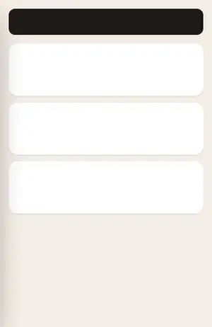

*N8 Menú lateral.*

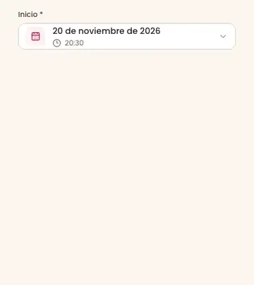

*N10 Selector de fecha y hora.*

| # | Animación | Plataforma | Dónde y disparador | Duración y curva | Movimiento reducido | Código |
|---|---|---|---|---|---|---|
| N1 | Avance en el stack | App | Al abrir una pantalla: `slide_from_right` en los stacks principal, de vinos y de eventos; el avance predeterminado de la plataforma en los stacks de rutas, administración y partners | Predeterminado del stack nativo | Fundido en lugar de deslizamiento | `frontend-mobile/app/(app)/_layout.tsx`, `app/(app)/(tabs)/wines/_layout.tsx`, `app/(app)/(tabs)/events/_layout.tsx`, `app/(app)/(tabs)/routes/_layout.tsx`, `app/(app)/admin/_layout.tsx`, `app/(app)/partner/_layout.tsx`, [`reducedMotion.ts`](../../../../frontend-mobile/src/presentation/components/ui/motion/reducedMotion.ts) |
| N2 | Stack de autenticación | App | Pantallas de ingreso, registro y recuperación: `slide_from_bottom` | Predeterminado del stack nativo | Fundido en lugar de deslizamiento | `frontend-mobile/app/(auth)/_layout.tsx` |
| N3 | Stacks raíz y de onboarding | App | Navegador raíz y onboarding: `fade` | Predeterminado del stack nativo | Sin cambios (es un fundido) | [`RootNavigator.tsx`](../../../../frontend-mobile/src/presentation/navigation/RootNavigator.tsx), `frontend-mobile/app/(onboarding)/_layout.tsx` |
| N4 | Modales de diálogo | App | `Modal` de React Native con `animationType="fade"`: reautenticación, eliminar cuenta, confirmación de notificación, recorte de imagen, celebración de nivel | Predeterminado de la plataforma | Sin cambios (es un fundido) | [`ReauthenticationDialog.tsx`](../../../../frontend-mobile/src/presentation/features/auth/ReauthenticationDialog.tsx), [`DeleteAccountDialog.tsx`](../../../../frontend-mobile/src/presentation/features/user/DeleteAccountDialog.tsx), [`NotificationConfirmDialog.tsx`](../../../../frontend-mobile/src/presentation/features/admin/notifications/NotificationConfirmDialog.tsx), [`ImageCropModal.tsx`](../../../../frontend-mobile/src/presentation/components/features/media/ImageCropModal.tsx) |
| N5 | Modales tipo hoja | App | `Modal` de React Native con `animationType="slide"`: hoja de filtros, detalle del panel de administración, tarjeta de bienvenida de puntos, reseña de la bodega | Predeterminado de la plataforma | Fundido en lugar de deslizamiento ([`reducedMotion.ts`](../../../../frontend-mobile/src/presentation/components/ui/motion/reducedMotion.ts)) | [`FilterSheet.tsx`](../../../../frontend-mobile/src/presentation/components/ui/FilterSheet.tsx), [`AdminDetailSheet.tsx`](../../../../frontend-mobile/src/presentation/features/admin/AdminDetailSheet.tsx), [`PointsWelcomeCard.tsx`](../../../../frontend-mobile/src/presentation/features/points/PointsWelcomeCard.tsx), [`CellarReviewSheet.tsx`](../../../../frontend-mobile/src/presentation/features/cellar/CellarReviewSheet.tsx) |
| N6 | Bottom sheet | App | `BottomSheetModal` (`@gorhom/bottom-sheet`): formularios y superposiciones de detalle | Animación de ajuste predeterminada de la biblioteca | La biblioteca sigue el ajuste del sistema (Reanimated) | [`AppProviders.tsx`](../../../../frontend-mobile/src/presentation/providers/AppProviders.tsx) |
| N7 | Cámara del mapa | App | El mapa de eventos se centra en la selección; el selector de ubicación se mueve al punto elegido | Eventos 450 ms; selector de ubicación 250 ms | Sin cambios (cámara nativa del mapa) | [`EventsScreen.tsx`](../../../../frontend-mobile/src/presentation/screens/events/EventsScreen.tsx), [`LocationPickerMap.tsx`](../../../../frontend-mobile/src/presentation/components/features/location/LocationPickerMap.tsx) |
| N8 | Menú lateral | Web | Botón de menú por debajo de `lg`: el panel entra desde la izquierda sobre un fondo desenfocado; 150 ms después los enlaces entran uno por uno | Panel 300 ms `ease-out`; fondo 300 ms; enlaces 300 ms cada uno, con 50 ms de diferencia, desde `translateX(-16px)` | Panel y enlaces aparecen de inmediato, sin deslizamiento ni escalonado | [`AppSidebar.tsx`](../../../../frontend-react/src/presentation/components/layout/AppSidebar.tsx) |
| N9 | Fondo del modal | Web | `Modal` y `ConfirmDialog` se montan con su fondo | El fondo declara `transition-opacity`; el diálogo no tiene animación de entrada | Sin cambios | [`Modal.tsx`](../../../../frontend-react/src/presentation/components/ui/Modal.tsx) |
| N10 | Selector de fecha y hora | Web | El campo de fecha del formulario de eventos abre su calendario | 140 ms `ease-out`, desde `translateY(-4px) scale(0.98)` con fundido; se cierra de inmediato | Se abre sin movimiento | [`EventDateTimeField.css`](../../../../frontend-react/src/presentation/components/features/event/EventDateTimeField.css) |
| N11 | Desplazamiento suave | Web | La búsqueda de vinos, las rutas del vino y los eventos cercanos vuelven arriba al cambiar de página; el detalle del vino baja a las reseñas; la comparación baja al recorrido | Desplazamiento suave del navegador | Desplazamiento instantáneo (`auto` o `instant`) | [`useWineSearchViewModel.ts`](../../../../frontend-react/src/presentation/pages/wines/useWineSearchViewModel.ts), [`useWineRoutesViewModel.ts`](../../../../frontend-react/src/presentation/pages/wine-routes/useWineRoutesViewModel.ts), [`useEventsNearbyViewModel.ts`](../../../../frontend-react/src/presentation/pages/events/useEventsNearbyViewModel.ts), [`useWineDetailsViewModel.ts`](../../../../frontend-react/src/presentation/pages/wines/useWineDetailsViewModel.ts), [`WineComparePage.tsx`](../../../../frontend-react/src/presentation/pages/wines/WineComparePage.tsx) |

## 4. Visualización de datos

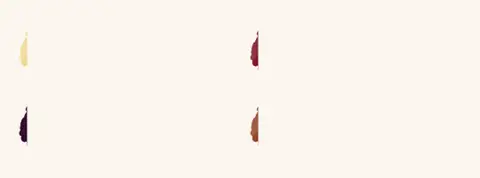

*D1 y D2 Pincelada del color del vino y lavado de reflejos, un pincel por profundidad.*

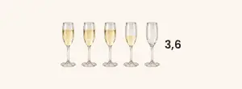

*D3 Burbujas en las copas de calificación.*

*D4 Calificación con botella, con la demostración translúcida y un arrastre.*

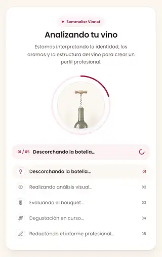

*D5 Recorrido del proceso de IA.*

*D6 Viñeta rotativa.*

*D7 Aparición de ilustración única.*

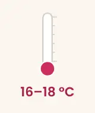

*D8 Termómetro de servicio.*

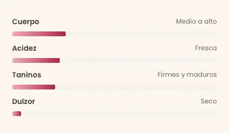

*D9 Barras del paladar y de puntaje.*

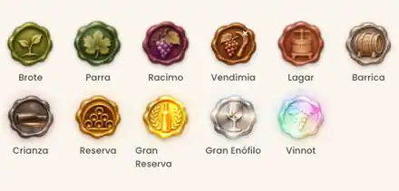

*D11 Efectos de los sellos, todos los niveles.*

| # | Animación | Plataforma | Dónde y disparador | Duración y curva | Movimiento reducido | Código |
|---|---|---|---|---|---|---|
| D1 | Pincelada del color del vino | Ambas | Línea de color del perfil de IA: la pincelada se pinta de izquierda a derecha al aparecer | 900 ms `cubic-bezier(.3,.7,.3,1)`; la app coincide | Pincelada completa, sin pintado | [Imágenes: pincelada de color del vino](imagery.md#pincelada-de-color-del-vino) |
| D2 | Lavado de reflejos | Ambas | Después del pintado, un lavado de cada tono de reflejo nombrado recorre el borde inferior de la pincelada, un tono por pasada | 4,2 s por tono `cubic-bezier(.45,0,.4,1)`, desde los 900 ms; la app coincide | Un lavado fijo, sin movimiento | [Imágenes: pincelada de color del vino](imagery.md#pincelada-de-color-del-vino) |
| D3 | Burbujas en las copas de calificación | Ambas | `GlassRating` con copas flauta (espumante), copas de 28 px o más llenas por encima del 15 % | Loop de 1,8 s, cuatro burbujas separadas por 0,45 s. Web `ease-in`; app `Easing.in(quad)` | Sin burbujas | [`rating.css`](../../../../frontend-react/src/presentation/components/ui/rating/rating.css), [`RatingGlass.tsx`](../../../../frontend-react/src/presentation/components/ui/rating/RatingGlass.tsx), [`RatingGlasses.tsx`](../../../../frontend-mobile/src/presentation/features/wine/rating/RatingGlasses.tsx) |
| D4 | Calificación con botella | Ambas | Formulario de reseña: abierta sin calificar, la botella se descorcha sola; mientras el navegador o el dispositivo haya calificado menos de tres veces, una botella translúcida muestra el arrastre dos veces; al arrastrar, la botella se inclina y sirve en las copas | Descorche 2200 ms `linear`; elevación y regreso 420 ms; inclinación 350 ms `cubic-bezier(.3,.7,.3,1)`; sostén del servido 260 ms; fundido del chorro 180 ms. Web: llenado de copa 0,09 s, trazo del chorro en loop de 0,35 s, barra 0,12 s, ciclo de la demostración 3,7 s. App: nivel 220 ms, paso 110 ms, ciclo de la demostración 3,4 s | Abierta desde el inicio, sin demostración, los valores cambian de inmediato | [`PourRating.tsx`](../../../../frontend-react/src/presentation/components/ui/rating/PourRating.tsx), [`pourGeometry.ts`](../../../../frontend-react/src/presentation/components/ui/rating/pourGeometry.ts), [`rating.css`](../../../../frontend-react/src/presentation/components/ui/rating/rating.css), [`RatingPourControl.tsx`](../../../../frontend-mobile/src/presentation/features/wine/rating/RatingPourControl.tsx) |
| D5 | Recorrido del proceso de IA | Ambas | Mientras la IA escribe un perfil o una comparación: una escena por paso, un anillo que se completa, la lista de pasos | Entrada de escena 450 ms (web `cubic-bezier(.33,1,.68,1)` con `scale(.97)`; app `FadeIn` 450, `FadeOut` 250); anillo 900 ms (app `Easing.out(cubic)`); gesto de 1600–3000 ms `linear` después de 120 ms; el último paso se repite: pausa 1600 ms, borrado 700 ms; burbujas 1500 ms. Los pasos cambian cada 1,8 s (perfil) o cada 2,2 s en la web y 2,5 s en la app (comparación) | Cada parte en su pose final; el anillo y las escenas cambian sin movimiento | [`AiProcessScene.tsx`](../../../../frontend-react/src/presentation/components/features/wine/aiProcess/AiProcessScene.tsx), [`aiProcessScene.css`](../../../../frontend-react/src/presentation/components/features/wine/aiProcess/aiProcessScene.css), [`aiProcessScenes.ts`](../../../../frontend-react/src/presentation/components/features/wine/aiProcess/aiProcessScenes.ts), [`WineProcessScene.tsx`](../../../../frontend-mobile/src/presentation/features/wine/WineProcessScene.tsx), [`WineProcessSceneArt.tsx`](../../../../frontend-mobile/src/presentation/features/wine/WineProcessSceneArt.tsx) |
| D6 | Viñeta rotativa | Ambas | Notas y maridajes del perfil de IA: una ilustración por vez en el mismo lugar | Una viñeta nueva cada 4500 ms. Web: fundido y escala `0.97 → 1 → 0.99` a lo largo del intervalo, `ease-in-out`. App: cambio de 1300 ms, la anterior sale antes de que aparezca la nueva, `Easing.inOut(sin)` | Hasta cuatro (web) o tres (app) viñetas lado a lado, quietas | [`RotatingVignette.tsx`](../../../../frontend-react/src/presentation/components/ui/RotatingVignette.tsx), [`globals.css`](../../../../frontend-react/src/shared/assets/styles/globals.css), [`RotatingVignette.tsx`](../../../../frontend-mobile/src/presentation/features/wine/profileArt/RotatingVignette.tsx) |
| D7 | Aparición de ilustración única | Web | Ilustración de servicio del perfil de IA y una lista de viñetas con un solo elemento | 500 ms `ease-out`, `scale(.92) → 1` con fundido | Aparece de inmediato | [`globals.css`](../../../../frontend-react/src/shared/assets/styles/globals.css), [`AiProfilePage.tsx`](../../../../frontend-react/src/presentation/pages/wines/AiProfilePage.tsx) |
| D8 | Termómetro de servicio | Ambas | Sección de servicio del perfil de IA: el mercurio sube hasta la temperatura de servicio | Web: 1200 ms `cubic-bezier(.3,.7,.3,1)` después de 200 ms. App: 1200 ms `Easing.out(cubic)`, sin demora | Mercurio en su nivel | [`ServingThermometer.tsx`](../../../../frontend-react/src/presentation/components/ui/ServingThermometer.tsx), [`ServingThermometer.tsx`](../../../../frontend-mobile/src/presentation/features/wine/profileArt/ServingThermometer.tsx), [`useAppearProgress.ts`](../../../../frontend-mobile/src/presentation/features/wine/profileArt/useAppearProgress.ts) |
| D9 | Barras del paladar y de puntaje | Ambas | Los puntajes del paladar del perfil de IA se llenan desde la izquierda | Web: escala de 900 ms `cubic-bezier(.3,.7,.3,1)` más una transición de ancho de 700 ms. App: 900 ms `Easing.out(cubic)` | Barras en su valor | [`AiProfilePage.tsx`](../../../../frontend-react/src/presentation/pages/wines/AiProfilePage.tsx), [`AiProfileSections.tsx`](../../../../frontend-mobile/src/presentation/features/wine/AiProfileSections.tsx) |
| D10 | Transiciones de ancho de barras | Web | Barras que cambian de ancho: comparación de vinos, perfil de sabor, capacidad del evento (tarjeta y detalle), estadísticas del perfil, fortaleza de la contraseña | Comparación 1000 ms `ease-out`; sabor 700 ms; capacidad 500 ms (tarjeta) y 700 ms `ease-out` (detalle); estadísticas 500 ms; contraseña 500 ms | El ancho cambia de inmediato | [`WineComparePage.tsx`](../../../../frontend-react/src/presentation/pages/wines/WineComparePage.tsx), [`WineTasteProfile.tsx`](../../../../frontend-react/src/presentation/components/features/wine/WineTasteProfile.tsx), [`EventCard.tsx`](../../../../frontend-react/src/presentation/components/features/event/EventCard.tsx), [`EventDetailsSidebar.tsx`](../../../../frontend-react/src/presentation/pages/events/EventDetailsSidebar.tsx), [`UserProfileStatsTab.tsx`](../../../../frontend-react/src/presentation/pages/user/UserProfileStatsTab.tsx), [`RegisterPasswordWithStrength.tsx`](../../../../frontend-react/src/presentation/pages/public/RegisterPasswordWithStrength.tsx) |
| D11 | Efectos de los sellos | Ambas | Sellos de lacre `UserBadge`. El modo `loop` (perfil, celebración, página de puntos) se reproduce sin fin; el modo `list` reproduce una ráfaga cuando el sello aparece y otra cada 8–16 s mientras está visible. En la web, los sellos de 60 px o más se inclinan hacia el puntero; en la app, los sellos marcados `interactive` siguen el toque | Por nivel, abajo. Inclinación 0,25 s `ease-out`. Destellos solo en sellos de 40 px o más | Sello quieto con un brillo fijo | [`userBadge.css`](../../../../frontend-react/src/presentation/components/features/points/userBadge.css), [`UserBadge.tsx`](../../../../frontend-react/src/presentation/components/features/points/UserBadge.tsx), [`sealMotion.ts`](../../../../frontend-react/src/presentation/components/features/points/sealMotion.ts), [`UserBadge.tsx`](../../../../frontend-mobile/src/presentation/features/points/UserBadge.tsx), [`SealCanvas.tsx`](../../../../frontend-mobile/src/presentation/features/points/SealCanvas.tsx), [`sealEffects.ts`](../../../../frontend-mobile/src/presentation/features/points/sealEffects.ts) |

Efectos de los sellos por nivel (los mismos ciclos en la web y en la app):

| Nivel | Efecto | Ciclo |
|---|---|---|
| Brote | balanceo | 4,2 s |
| Parra | balanceo, escala que respira y un brillo verde | 4,6 s |
| Racimo | respiración; las uvas maduran de verde a morado; brilla una gota de rocío | 5 s |
| Vendimia | destello a lo largo del cuchillo, un destello estelar | 3,8 s |
| Lagar | respiración y un barrido suave | 6,5 s |
| Barrica | barrido metálico sobre los aros | 4,2 s |
| Crianza | brillo satinado y un halo color vino | 4,8 s |
| Reserva | brillo dorado y un halo dorado | 4,4 s |
| Gran Reserva | rayos dorados lentos, halo, brillo en loop, lámina dorada, tres destellos | rayos 26 s, halo 3,6 s, brillo 2,8 s, lámina 8 s |
| Gran Enófilo | cromo giratorio, barrido, halo frío, cinco destellos | cromo 6 s, barrido y halo 3,4 s |
| Vinnot | lámina holográfica que sigue al puntero, barrido de color, purpurina, halo arcoíris, seis destellos, partículas que suben | lámina y halo 7 s, color 5,5 s, brillo 3,2 s, purpurina 1,6 s |

## 5. Decorativas y de onboarding

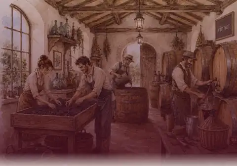

*O1 Revelado del hero del inicio.*

| # | Animación | Plataforma | Dónde y disparador | Duración y curva | Movimiento reducido | Código |
|---|---|---|---|---|---|---|
| O1 | Revelado del hero del inicio | Web | Carga de la página de inicio: título, texto y botones suben 24 px y aparecen con fundido; 600 ms después siguen las secciones | 1000 ms cada uno, el texto 200 ms y los botones 500 ms después; secciones de 1000 ms con demoras de 0–300 ms | Estado final de inmediato | [`HomePage.tsx`](../../../../frontend-react/src/presentation/pages/public/HomePage.tsx), [`useHomeViewModel.ts`](../../../../frontend-react/src/presentation/pages/public/useHomeViewModel.ts) |
| O2 | Tarjeta de ingreso y registro | Web | La tarjeta crece desde el 95 % y aparece con fundido al cargar | 700 ms | Aparece de inmediato | [`LoginPage.tsx`](../../../../frontend-react/src/presentation/pages/public/LoginPage.tsx), [`RegisterPage.tsx`](../../../../frontend-react/src/presentation/pages/public/RegisterPage.tsx) |
| O3 | Entrada del inicio | App | Al montar el inicio: fundido del hero, después texto, botones y secciones bajan (`FadeInDown`) en forma escalonada | 360–700 ms cada uno, demoras de 60–440 ms; elementos de lista separados por 32–70 ms | Predeterminado de Reanimated: sin entrada | [`HomeScreenView.tsx`](../../../../frontend-mobile/src/presentation/features/home/HomeScreenView.tsx), [`HomeScreenView.parts.tsx`](../../../../frontend-mobile/src/presentation/features/home/HomeScreenView.parts.tsx) |
| O4 | Bienvenida del onboarding | App | Pantalla de bienvenida: ilustración, texto y acciones aparecen con fundido y suben | 450–600 ms, demoras de 120–360 ms | Predeterminado de Reanimated: sin entrada | `frontend-mobile/app/(onboarding)/welcome.tsx` |
| O5 | Layout de autenticación | App | Ingreso y registro: fundido de la marca, el título y el formulario bajan | 380–520 ms, demoras de 90 y 160 ms | Predeterminado de Reanimated: sin entrada | [`AuthLayout.tsx`](../../../../frontend-mobile/src/presentation/features/auth/AuthLayout.tsx) |
| O6 | Pantalla de inicio de la app | App | Arranque: fundido de la marca gráfica, el nombre baja | 350 ms; 420 ms después de 180 ms | Predeterminado de Reanimated: sin entrada | [`VinnotLaunchScreen.tsx`](../../../../frontend-mobile/src/presentation/features/auth/VinnotLaunchScreen.tsx) |
| O7 | Encabezado de exploración | App | Los encabezados de vinos, eventos y rutas bajan al montarse | 420 ms `FadeInDown` | Predeterminado de Reanimated: sin entrada | [`BrowseScreenHeader.tsx`](../../../../frontend-mobile/src/presentation/components/layout/BrowseScreenHeader.tsx) |
| O8 | Resultados de vinos | App | Los resultados de búsqueda suben (`FadeInUp`), los primeros siete en forma escalonada | 340 ms, separados por 45 ms | Predeterminado de Reanimated: sin entrada | [`WineResultsList.tsx`](../../../../frontend-mobile/src/presentation/features/wine/WineResultsList.tsx) |
| O9 | Fundido de imágenes | App | Las imágenes de `expo-image` aparecen con fundido al cargar (`ImageWithFallback`, ilustraciones del inicio y de feedback) | 220 ms de forma predeterminada, 180 ms para respaldos e ilustraciones | Sin fundido (transición 0) | [`ImageWithFallback.tsx`](../../../../frontend-mobile/src/presentation/components/ui/ImageWithFallback.tsx) |

## Agregar una animación

- Asignarle un propósito según los principios; la decoración sola no es motivo.
- Tomar duraciones y curvas de los tokens, o nombrar un token nuevo.
- Definir su estado con movimiento reducido en el mismo cambio y verificarlo
  con el ajuste del sistema activo.
- Agregar su fila aquí, en los dos idiomas, con una vista previa cuando sea
  propia de Vinnot.
