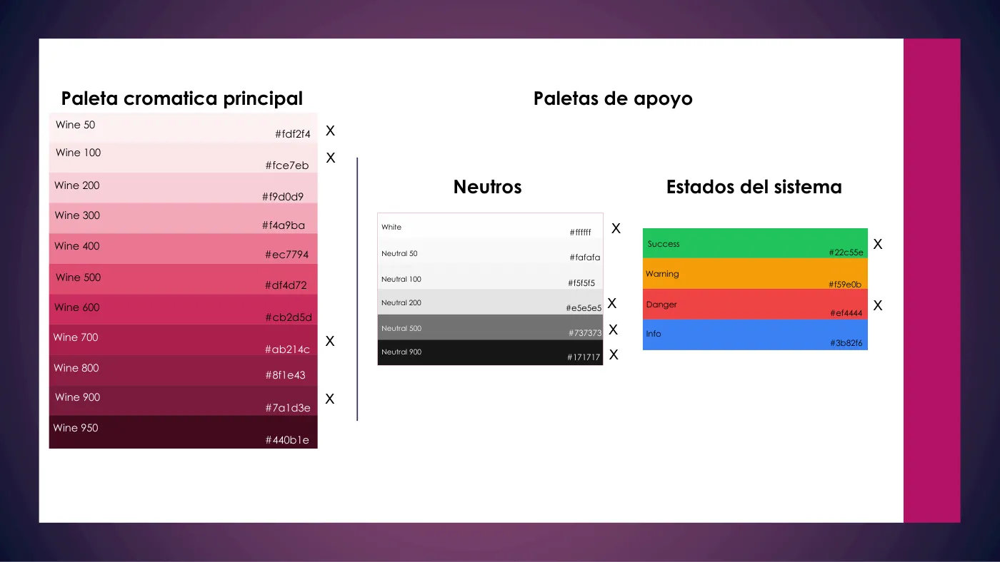
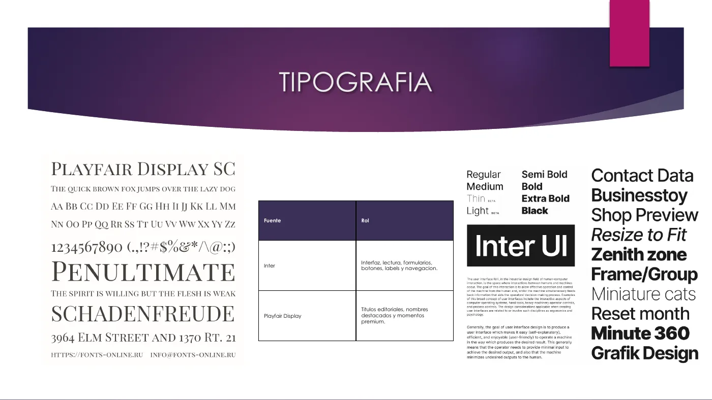
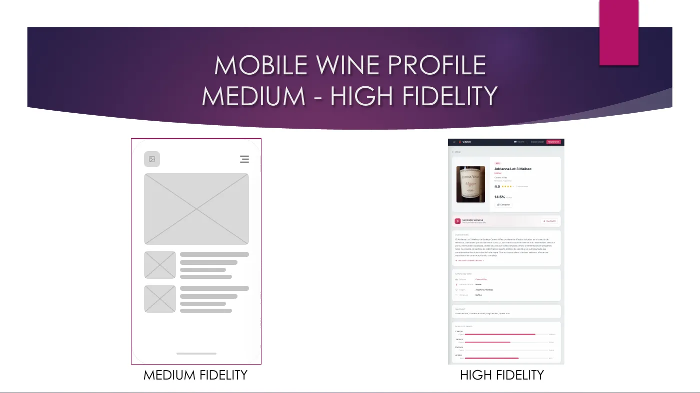
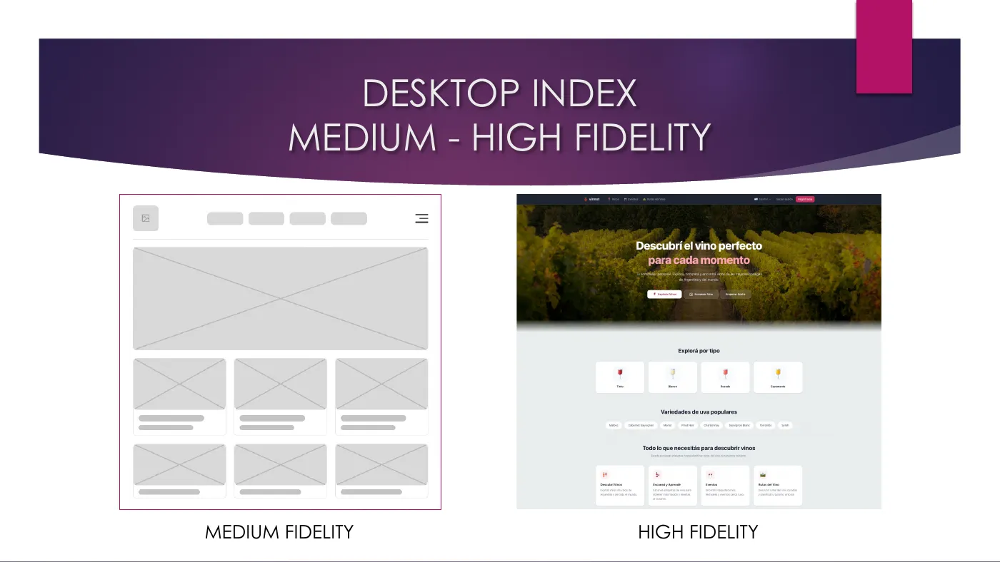
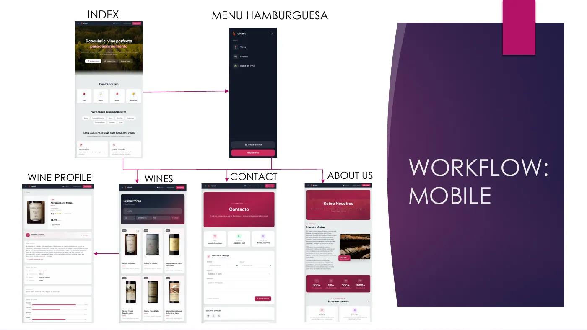

# Diseño original

> **Documento histórico.** Esta página registra el primer diseño y no se
> mantiene contra el código; algunas afirmaciones sobre el uso actual, como las
> fuentes, están desactualizadas. La guía vigente es el [sistema visual](visual-system.md).

Primer diseño de Vinnot, hecho antes de construir la web y la app. Define los dispositivos de referencia, el menú, los wireframes de baja, media y alta fidelidad, los recorridos entre pantallas, la paleta, la tipografía, la iconografía y las cards. El [sistema visual](visual-system.md) describe el diseño que usa hoy el código.

[Descargar el documento completo (PDF, 73 páginas)](files/vinnot-original-design.pdf)

## Contenido del documento

| Sección | Qué define |
|---|---|
| Tipos de web | Contexto: de la web 1.0 a la 5.0 |
| Dispositivos | Resoluciones de referencia. Mobile: iPhone 17 (2622 × 1206), Motorola Signature (2780 × 1264), Samsung S26 (1080 × 2340). Tablet: iPad Pro 13 (2752 × 2064), Moto Pad 2026 (1600 × 2560), Samsung Tab S11 (2960 × 1848). Desktop: MacBook Air 15" (2880 × 1864), Galaxy Book Pro 15,6" (1920 × 1080), Moto Book 60 14" (2880 × 1800) |
| Menú hamburguesa | Referencias de navegación |
| Wireframes | Inicio, Vinos, Ficha del vino, Contacto y Sobre nosotros en mobile, tablet y desktop, de baja a alta fidelidad |
| Workflows | Recorrido entre esas pantallas en cada dispositivo |
| Elementos | Colores, tipografía, iconografía y cards |

## Paleta

La paleta Wine, de Wine 50 a Wine 950, es la misma que usan hoy la web y la app ([`tailwind.css`](../../../../frontend-react/src/shared/assets/styles/tailwind.css)). Wine 700 (`#ab214c`) es el color principal de marca.

## Tipografía

El diseño original elegía Inter para la interfaz y Playfair Display para títulos editoriales. Hoy la web y la app usan una sola familia, Poppins, para todo el texto, títulos incluidos: en la web la cargan [`globals.css`](../../../../frontend-react/src/shared/assets/styles/globals.css) (pesos 400 a 700) y [`tailwind.css`](../../../../frontend-react/src/shared/assets/styles/tailwind.css) (`--font-sans`); en la app, [`_layout.tsx`](../../../../frontend-mobile/app/_layout.tsx) con `@expo-google-fonts/poppins` y [`typography.ts`](../../../../frontend-mobile/src/shared/theme/typography.ts). No queda Inter ni Playfair Display en el código.

Por qué Poppins:

- **Una sola familia en web y app.** El mismo texto se ve igual en el navegador, en iOS y en Android, y se cargan menos archivos de fuentes.
- **Legible en tamaños chicos.** Es una sans geométrica de letras abiertas y altura x generosa, que se lee bien en etiquetas, precios y botones de pantallas de teléfono.
- **Jerarquía con pesos, no con otra familia.** Los títulos van de 500 a 700 y el texto usa 400 y 500; así el tono editorial no depende de una serif.
- **Libre.** Tiene licencia SIL Open Font License, sin costo ni límites de uso para la web y las apps de las tiendas.

## De wireframe a alta fidelidad

## Recorrido en mobile

